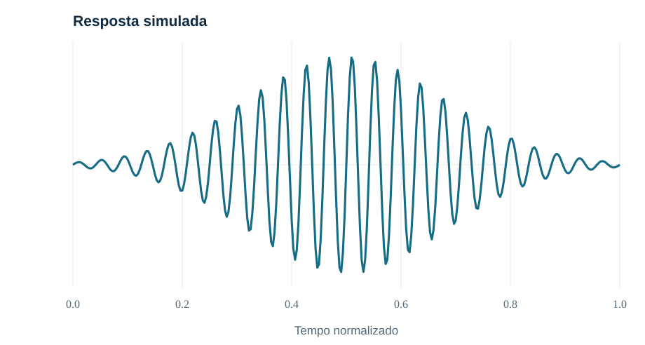

## Capa {.slide-capa data-background-color="#112c41"}

::: {.capa-conteudo}
[MODELO DE APRESENTAÇÃO CIENTÍFICA]{.sobretitulo-capa}

[Metrologia, dados e decisões confiáveis]{.titulo-capa}

::: {.capa-linha}
:::

[Uma demonstração de estilos para palestras, aulas e apresentações de resultados]{.subtitulo-capa}

::: {.capa-identificacao}
**Ruan Carvalho Mayworm**

Engenharia · Metrologia · Métodos computacionais

*Apresentação demonstrativa — v0.4 · 2026*
:::
:::

::: {.notes}
Esta capa demonstra a identidade visual. Substituir título, evento e data em apresentações reais.
:::

## Uma apresentação científica deve facilitar decisões

[01 · CONCEITO]{.etiqueta-topo}

::: {.frase-destaque}
A comunicação técnica deve separar claramente **evidências**, **hipóteses** e **conclusões**.
:::

::: {.faixa-sintese}
Design editorial discreto · informação legível · rastreabilidade científica
:::

::: {.notes}
Slide demonstrativo para apresentar uma mensagem principal.
:::

## Três níveis de informação

[02 · ESTRUTURA]{.etiqueta-topo}

:::: {.grade-tres}
::: {.cartao-pilar}
[01]{.numero-pilar}

<div class="titulo-pilar">Contexto</div>

Qual problema de medição estamos tentando resolver?

[JUSTIFICATIVA]{.rodape-pilar}
:::

::: {.cartao-pilar}
[02]{.numero-pilar}

<div class="titulo-pilar">Método</div>

Quais modelos, dados e hipóteses sustentam a análise?

[PROCEDIMENTO]{.rodape-pilar}
:::

::: {.cartao-pilar}
[03]{.numero-pilar}

<div class="titulo-pilar">Resultado</div>

O que a evidência permite concluir — e com qual limitação?

[INTERPRETAÇÃO]{.rodape-pilar}
:::
::::

## Equações com contexto metrológico

[03 · EQUAÇÕES]{.etiqueta-topo}

:::: {.columns}
::: {.column width="57%"}

::: {.caixa-equacao}
**Incerteza-padrão combinada**

$$u_c(y)=\sqrt{\sum_{i=1}^{N}\left(\frac{\partial f}{\partial x_i}\right)^2u^2(x_i)}$$

[Expressão para componentes não correlacionadas e aproximação linear.]{.nota-equacao}
:::

:::
::: {.column width="43%"}

::: {.painel-lateral}
<div class="titulo-painel">Ao apresentar uma equação</div>

- Definir símbolos e unidades.
- Explicitar hipóteses.
- Separar o modelo matemático de sua aplicação.
- Identificar simplificações e limitações.
:::

:::
::::

::: {.notes}
A expressão assume ausência de correlações e linearização de primeira ordem.
:::

## Visualização com Python

[04 · GRÁFICOS]{.etiqueta-topo}

:::: {.columns}
::: {.column width="66%"}

::: {.moldura-grafico}
{fig-alt="Sinal ultrassônico sintético com envoltória gaussiana em função do tempo normalizado."}
:::

:::
::: {.column width="34%"}

::: {.painel-resultado}
[EXEMPLO DIDÁTICO]{.selo-exemplo}

<div class="titulo-resultado">Sinal simulado</div>

Gráfico SVG de uma onda modulada, produzido a partir de dados artificiais.

::: {.divisor-fino}
:::

**Observação:** os dados são sintéticos e não representam resultados experimentais.
:::

:::
::::

::: {.notes}
A figura é sintética e serve apenas à demonstração da composição visual.
:::

## Apresentação de código Python

[05 · CÓDIGO]{.etiqueta-topo}

:::: {.columns}
::: {.column width="65%"}
::: {.codigo-cientifico}
[EXEMPLO SINTÉTICO · PYTHON 3]{.etiqueta-codigo}

```{.python code-line-numbers="true"}
from math import sqrt
from statistics import mean, stdev

leituras_mm = [10.012, 10.018, 10.015, 10.011]
n = len(leituras_mm)
media_mm = mean(leituras_mm)
u_media_mm = stdev(leituras_mm) / sqrt(n)

print(f"{media_mm:.3f} ± {u_media_mm:.3f} mm")
```
:::
:::
::: {.column width="35%"}
::: {.painel-codigo}
<div class="titulo-codigo">Do dado ao resultado</div>

**Entrada:** quatro leituras sintéticas de comprimento (mm).

**Processamento:** média e incerteza-padrão tipo A da média.

**Hipótese:** leituras independentes e da mesma distribuição.
:::
:::
::::

::: {.faixa-codigo}
**Exemplo demonstrativo:** sem bibliotecas externas. Uma avaliação completa pode exigir outras contribuições de incerteza.
:::

::: {.notes}
Bloco estático para apresentação de código; não é executado pelo Quarto. Dados sintéticos. Hipóteses de independência e mesma distribuição.
:::
## Resultados numéricos e rastreabilidade

[06 · TABELAS]{.etiqueta-topo}

| Grandeza | Estimativa | Incerteza-padrão |
|:--|--:|--:|
| Comprimento | 10,020 mm | 0,006 mm |
| Temperatura | 22,4 °C | 0,2 °C |
| Velocidade | 1 480 m/s | 3 m/s |

::: {.faixa-observacao}
**Dados sintéticos.** Os valores são ilustrativos, não compõem um orçamento de incerteza e não devem ser interpretados como resultados rastreáveis.
:::

::: {.notes}
Demonstração de tabela. As grandezas não pertencem ao mesmo modelo de medição.
:::

## Uma sequência visual para explicar métodos

[07 · FLUXOGRAMAS]{.etiqueta-topo}

:::: {.fluxo-metodo}
::: {.etapa-metodo}
[1]{.indice-etapa}

**Definir**

Mensurando e modelo
:::

::: {.etapa-metodo}
[2]{.indice-etapa}

**Medir**

Aquisição e controle
:::

::: {.etapa-metodo}
[3]{.indice-etapa}

**Avaliar**

Qualidade e incerteza
:::

::: {.etapa-metodo}
[4]{.indice-etapa}

**Decidir**

Critério e interpretação
:::
::::

::: {.faixa-sintese}
A comunicação visual complementa o argumento técnico; não substitui a documentação do método.
:::

## Referências

[08 · REFERÊNCIAS]{.etiqueta-topo}

::: {.lista-referencias}

::: {.referencia-item}
**[1]** JCGM (2008). *Evaluation of measurement data — Guide to the expression of uncertainty in measurement* (JCGM 100:2008).
:::

::: {.referencia-item}
**[2]** JCGM (2012). *International vocabulary of metrology — Basic and general concepts and associated terms (VIM)* (JCGM 200:2012).
:::

::: {.referencia-item}
**[3]** Quarto Project. *Reveal.js Presentations*. [Documentação oficial](https://quarto.org/docs/presentations/revealjs/).
:::

:::

::: {.aviso-referencias}
**Referências demonstrativas.** Substitua pelas fontes efetivamente utilizadas em cada palestra. Se necessário, distribua a bibliografia em mais de um slide.
:::

::: {.notes}
Este slide ilustra um padrão bibliográfico. Conferir edição, ano, identificação e fonte das referências ao produzir uma apresentação real.
:::

## Obrigado {.slide-fecho data-background-color="#112c41"}

::: {.fecho-conteudo}

[Obrigado!]{.titulo-fecho .titulo-obrigado}

::: {.capa-linha}
:::

::: {.bloco-apresentacao}
[LINK DA APRESENTAÇÃO]{.rotulo-contato}

[rcmayworm.github.io/previas/modelo-apresentacoes-v01/](https://rcmayworm.github.io/previas/modelo-apresentacoes-v01/){.link-apresentacao}
:::

::: {.bloco-contatos}
[CONTATO]{.rotulo-contato .titulo-contato}

:::: {.grade-contatos}

::: {.contato-item}
**E-mail:** [rcmayworm@gmail.com](mailto:rcmayworm@gmail.com)
:::

::: {.contato-item}
**Site pessoal:** [rcmayworm.github.io](https://rcmayworm.github.io/)
:::

::: {.contato-item}
**Currículo Lattes:** [Acessar currículo](http://lattes.cnpq.br/5951712664292058)
:::

::: {.contato-item}
**LinkedIn:** [linkedin.com/in/ruanmayworm](https://www.linkedin.com/in/ruanmayworm/)
:::

::::

:::

:::

::: {.notes}
Substitua o link da apresentação pelo endereço final de cada evento. Conferir os contatos antes de divulgar.
:::
