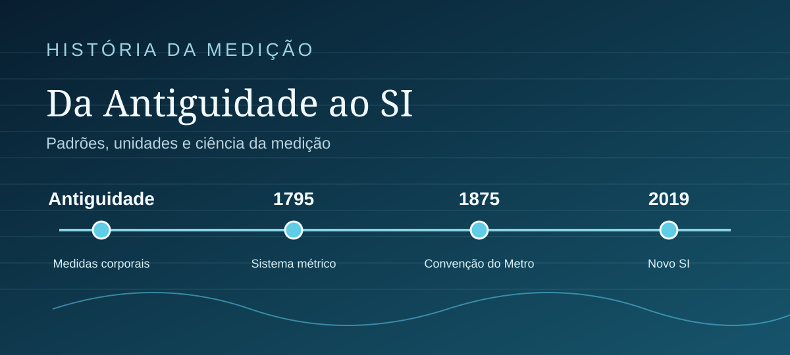
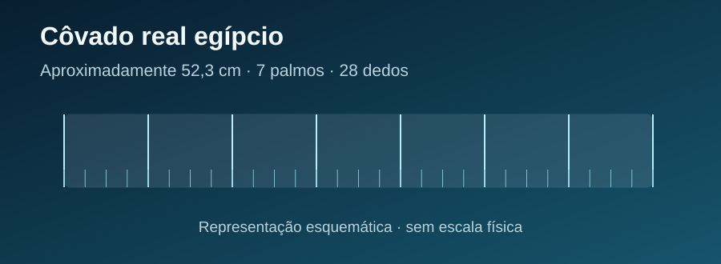
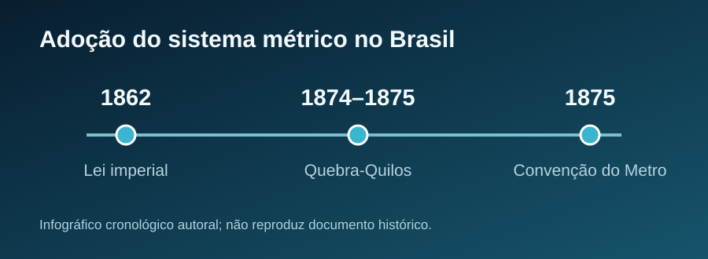

> **Sobre esta edição:** artigo autoral originalmente publicado no [LinkedIn (13/02/2025)](https://www.linkedin.com/pulse/fascinante-jornada-da-metrologia-antiguidade-aos-dias-ruan-mayworm-9l8of/) e reproduzido pela [ASMETRO-SI (14/02/2025)](https://asmetro.org.br/portalsn/2025/02/14/a-fascinante-jornada-da-metrologia-da-antiguidade-aos-dias-atuais/). Esta versão foi adaptada para leitura na web, com atualização de alguns dados históricos e metrológicos e **ilustrações esquemáticas originais**, diferentes das imagens da publicação anterior.

{fig-alt="Ilustração vetorial original com marcos da história da medição" fig-cap="Evolução dos padrões de medição. Ilustração esquemática preparada para esta edição."}

Desde os primórdios da civilização, a medição tem sido uma ferramenta essencial para o desenvolvimento humano. A metrologia, que é a ciência da medição, percorreu uma longa e fascinante jornada repleta de descobertas, desafios e curiosidades. Sua evolução reflete a busca constante da humanidade por precisão, ordem e progresso.

## As primeiras medidas e os padrões da Antiguidade

Na Antiguidade, diversas unidades de comprimento tinham origem em partes do corpo humano. O côvado, por exemplo, relacionava-se à medida do antebraço, mas seu valor variava entre regiões e períodos. O **côvado real egípcio**, empregado em construções monumentais, tinha aproximadamente **52,3 cm** e era subdividido em sete palmos de quatro dedos. Outras tradições empregaram côvados menores, próximos de 45 cm. De forma semelhante, o pé e a polegada foram utilizados historicamente em diferentes sistemas de medidas. [Fonte: estudo histórico sobre o côvado](https://doi.org/10.1155/2014/489757).

Unidades definidas apenas por referências corporais individuais podiam variar de pessoa para pessoa. A utilização de padrões materiais ajudou a tornar as medidas mais consistentes. As pirâmides de Gizé são exemplos notáveis do domínio de técnicas de levantamento, orientação e construção na Antiguidade; estimativas numéricas de sua precisão dependem do levantamento considerado e do estado de conservação.

No Egito, a existência de réguas e padrões de côvado demonstra a preocupação com a uniformidade das medidas. Narrativas populares sobre punições com a morte pelo descumprimento da calibração não foram aqui tratadas como fatos históricos, por falta de documentação primária suficiente.

{fig-cap="Côvado real egípcio e suas subdivisões. Ilustração conceitual, sem escala física."}

Uma referência cultural antiga encontra-se na Bíblia, em Gênesis 6:15, que descreve a Arca de Noé com 300 côvados de comprimento, 50 de largura e 30 de altura. **Adotando hipoteticamente** um côvado de 45 cm, obtêm-se 135 m, 22,5 m e 13,5 m, respectivamente. Esses valores ilustram a conversão de unidades históricas e **não representam uma medição arqueológica**; outras convenções para o côvado levam a resultados diferentes.

A passagem mostra como unidades antigas também permanecem presentes em textos culturais e religiosos.

## A criação do metro e a padronização das unidades

Com o crescimento das transações comerciais e das obras de engenharia, surgiu a necessidade de padrões universais. No final do século XVIII, os franceses introduziram o metro como unidade de comprimento, definido como a décima milionésima parte de um quarto do meridiano terrestre. Essa definição foi estabelecida após medições realizadas pelos astrônomos Delambre e Méchain entre Dunkerque, na França, e Montjuïc, na Espanha.

A história dessa missão, repleta de desafios políticos, geográficos e pessoais, é narrada no livro “A Medida de Todas as Coisas”, de Ken Alder, que revela as dificuldades enfrentadas pelos cientistas e o impacto do projeto na ciência moderna. Apesar de revolucionária, a definição original não era perfeita devido a imprecisões nas medições geográficas. Para materializar o conceito, criou-se uma barra de platina que serviu como padrão.

Desde 1983, a definição do metro está associada à velocidade da luz no vácuo; no SI atual, ela decorre da fixação do valor numérico de \(c=299\,792\,458\ \mathrm{m\,s^{-1}}\), juntamente com a definição do segundo. [Histórico oficial do metro — BIPM](https://www.bipm.org/en/history-si/metre).

No Brasil, a adoção do sistema métrico esteve fortemente ligada ao imperador Dom Pedro II, um entusiasta das ciências. Em **26 de junho de 1862**, a Lei Imperial nº 1.157 determinou a adoção do sistema métrico no país, prevendo um período de transição. A mudança, entretanto, enfrentou resistência popular, especialmente entre comerciantes e artesãos que estavam acostumados às antigas unidades de medida, como palmos e polegadas.

A resistência à adoção das novas medidas fez parte do contexto da **Revolta dos Quebra-Quilos**, ocorrida principalmente em **1874 e 1875** em províncias do Nordeste brasileiro. O movimento envolveu a destruição de pesos e medidas e expressou também insatisfações com tributos, recrutamento militar e ações das autoridades. A transição para padrões uniformes não ocorreu sem conflitos. [Fonte: Arquivo Nacional](https://historialuso.an.gov.br/index.php?Itemid=121&catid=2087&id=5734%3Asistema-metrico-decimal&option=com_content&view=article).

{fig-cap="Marcos históricos do sistema métrico no Brasil e da cooperação internacional. Infográfico autoral, não é um cartaz da época."}

## A metrologia na Revolução Industrial e no século XX

A Revolução Industrial trouxe um salto significativo na metrologia. A precisão tornou-se imprescindível para a produção em massa, incentivando o desenvolvimento de instrumentos como calibradores, paquímetros e balanças analíticas. Esses avanços permitiram controle rigoroso na fabricação de componentes industriais e na formulação de produtos químicos e farmacêuticos.

Um momento decisivo da cooperação internacional foi a assinatura da **Convenção do Metro, em 20 de maio de 1875**, tratado que criou o Bureau Internacional de Pesos e Medidas (BIPM) e estabeleceu uma estrutura permanente para a uniformização das medições. [Fonte: BIPM](https://www.bipm.org/en/metre-convention/).

Na metrologia contemporânea, a **rastreabilidade metrológica** é uma propriedade de um *resultado de medição* que pode ser relacionado a uma referência por uma cadeia documentada e ininterrupta de calibrações, com contribuição de incerteza em cada etapa. Não deve ser confundida com uma propriedade intrínseca de um instrumento. [VIM, item 2.41](https://jcgm.bipm.org/vim/en/2.41.html).

No século XX, com o advento da eletrônica e da óptica, a metrologia alcançou precisões inimagináveis. Tecnologias como a medição óptica e instrumentos eletrônicos permitiram avanços em áreas como nanotecnologia e microeletrônica. Além disso, padrões passaram a ser definidos por constantes físicas. O segundo, por exemplo, é baseado na frequência de transição do átomo de césio, enquanto o quilograma foi redefinido em termos da constante de Planck.

Relógios atômicos modernos oferecem estabilidade e exatidão extraordinárias, essenciais para aplicações como navegação por satélite, telecomunicações e sincronização de sistemas. Entretanto, a estimativa de quanto um relógio acumularia de erro ao longo de milhões de anos **depende do modelo e das condições de operação**; não é um desempenho universal de todos os relógios atômicos.

{fig-cap="Grandezas e constantes que fundamentam definições atuais do SI. Esquema autoral, não representa um relógio ou equipamento específico."}

## A metrologia no cotidiano e no futuro

Hoje, a metrologia está profundamente integrada ao cotidiano, embora muitas vezes passe despercebida. No abastecimento de veículos, o controle metrológico das bombas ajuda a assegurar que as quantidades indicadas atendam aos requisitos e erros máximos permitidos aplicáveis. Nos hospitais, medições confiáveis são fundamentais para exames laboratoriais e equipamentos médicos. No e-commerce, mede com precisão o peso e as dimensões dos produtos para cálculo de frete.

Outro exemplo cotidiano é a medição da pressão arterial, essencial para monitorar a saúde de milhões de pessoas no mundo. Já no setor agrícola, instrumentos metrológicos garantem que insumos sejam aplicados de maneira eficiente, otimizando a produtividade e reduzindo impactos ambientais.

No futuro, a metrologia continuará desempenhando um papel central no avanço tecnológico, especialmente com a crescente automação e digitalização. Áreas como a inteligência artificial e a Internet das Coisas dependem de sensores cada vez mais precisos, integrados a sistemas de medição confiáveis. Além disso, a metrologia quântica, que explora fenômenos subatômicos para alcançar níveis inéditos de precisão, promete revolucionar campos como telecomunicações, computação e exploração espacial.

A história da metrologia é um reflexo do progresso humano, desde as medições rudimentares baseadas no corpo humano até a sofisticação dos padrões modernos baseados em constantes universais. Essa evolução não apenas transformou a ciência e a tecnologia, mas também moldou a maneira como interagimos com o mundo. E você, já parou para pensar em como a metrologia impacta a sua vida?

## Referências e fontes de consulta

- [Bureau Internacional de Pesos e Medidas (BIPM). *The International System of Units (SI)*, 9ª edição, atualizada.](https://www.bipm.org/en/publications/si-brochure/)
- [JCGM. *Vocabulário Internacional de Metrologia (VIM)*, item 2.41 — rastreabilidade metrológica.](https://jcgm.bipm.org/vim/en/2.41.html)
- [BIPM. *The Metre Convention* (1875).](https://www.bipm.org/en/metre-convention/)
- [BIPM. *Historical perspective: metre*.](https://www.bipm.org/en/history-si/metre)
- [Arquivo Nacional. *Sistema Métrico Decimal*: implantação no Brasil e Revolta dos Quebra-Quilos.](https://historialuso.an.gov.br/index.php?Itemid=121&catid=2087&id=5734%3Asistema-metrico-decimal&option=com_content&view=article)
- [Stone, R. J. *The Cubit: A History and Measurement Commentary* (2014).](https://doi.org/10.1155/2014/489757)
- Alder, Ken. *A Medida de Todas as Coisas: A Extraordinária História da Busca pelo Metro Padrão*. Jorge Zahar Editor, 2004. Referência do artigo original; dados editoriais não revalidados nesta edição.
- *Bíblia Sagrada*. Gênesis 6:15 (referência cultural, não evidência metrológica experimental).

---

*Adaptação editorial de texto autoral previamente publicado; quatro figuras vetoriais originais foram preparadas para esta versão. Não foram reproduzidas imagens de terceiros sem licença verificada.*
