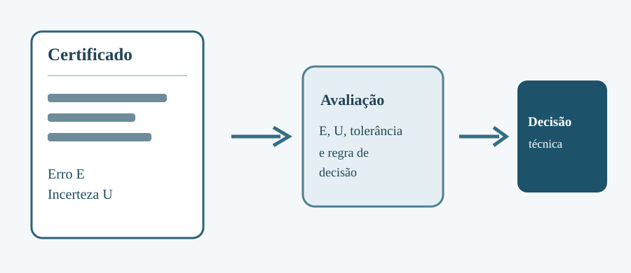
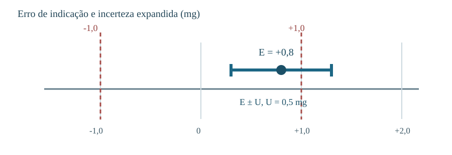

> **Sobre esta edição:** adaptação para leitura no site acadêmico de um artigo autoral publicado originalmente no [LinkedIn](https://www.linkedin.com/pulse/an%C3%A1lise-cr%C3%ADtica-de-certificados-calibra%C3%A7%C3%A3o-um-guia-pr%C3%A1tico-mayworm-vlvyf/) em 2025-10-14. A estrutura temática e os exemplos principais foram preservados, com redação editada para a web e ilustrações técnicas novas. As imagens originais do LinkedIn não foram reutilizadas por não terem sido recuperadas em qualidade verificável. As notas técnicas adicionais são identificadas como esclarecimentos desta edição.

{fig-cap="Análise de certificado: resultado de calibração e critério de aceitação. Esquema didático original."}

O certificado de calibração não deve ser tratado apenas como evidência documental de que um equipamento passou por um laboratório. Os resultados registrados nele precisam ser confrontados com os requisitos da aplicação. Uma medição utilizada para aprovar um produto, por exemplo, requer uma decisão fundamentada sobre erro, incerteza e tolerância.

## O que o certificado informa

O documento apresenta as condições e os resultados de uma calibração, incluindo identificação do item, método, grandezas e valores medidos. A calibração **não equivale automaticamente a uma declaração de conformidade**: o usuário ainda precisa estabelecer e aplicar um critério adequado ao risco da decisão.

O item 7.8 da ISO/IEC 17025:2017 trata do relato de resultados. Na análise documental, vale verificar especialmente:

- laboratório, cliente, objeto e identificação unívoca do relatório;
- método, local e datas relevantes da atividade;
- resultados, unidades, incerteza e informações de rastreabilidade metrológica;
- ajustes efetuados, quando aplicáveis, e resultados antes/depois quando requeridos;
- eventuais declarações de conformidade e a regra de decisão utilizada.

Esta relação é uma síntese didática; **não substitui a leitura dos requisitos aplicáveis da norma**.

## Interpretando os resultados e a incerteza

O exemplo numérico do artigo original considera uma balança analítica com erro máximo admissível (EMA) de \(\pm 1{,}0\,\mathrm{mg}\). O certificado indica erro de \(+0{,}8\,\mathrm{mg}\) e incerteza expandida \(U=0{,}5\,\mathrm{mg}\), com fator de abrangência \(k=2\).

{#fig-exemplo-balanca fig-cap="Exemplo didático do artigo original: erro de +0,8 mg e incerteza expandida de 0,5 mg, ante limite de ±1,0 mg. O intervalo mostrado não é um limite absoluto para o erro verdadeiro."}

O valor absoluto do erro observado está abaixo do EMA, mas a incerteza precisa ser considerada pela **regra de decisão** adotada. Como ilustração, a regra conservadora \(|E|+U\leq EMA\) produziria:

\[
|0{,}8|+0{,}5=1{,}3\,\mathrm{mg}>1{,}0\,\mathrm{mg}.
\]

Portanto, **essa regra não permitiria declarar conformidade**. Outras regras podem conduzir a decisões diferentes, conforme requisitos e risco aceito. Não é correto interpretar \(E\pm U\) como limites determinísticos para o erro real.

## Exemplo de certificado fictício

No artigo do LinkedIn foi apresentado um exemplo fictício de certificado de uma balança analítica, atribuído ao laboratório fictício *Medida Certa Ltda.*. A figura original não está incorporada nesta edição, mas o exercício acima mantém o raciocínio e os valores numéricos descritos no texto.

## Conclusão

A análise crítica requer duas verificações diferentes: a **suficiência técnica do certificado** e a **adequação do instrumento ao uso previsto**. O resultado da calibração deve apoiar uma decisão documentada — liberação, ajuste, manutenção ou substituição — à luz da tolerância do processo e da incerteza associada.

## Referências indicadas no artigo original

- ABNT NBR ISO/IEC 17025:2017 — requisitos gerais para competência de laboratórios de ensaio e calibração.
- JCGM 200:2012 / Vocabulário Internacional de Metrologia (VIM).
- JCGM 100:2008 — Guia para expressão de incerteza de medição.
- Eurachem/CITAC — *Use of uncertainty information in compliance assessment* (2021).
