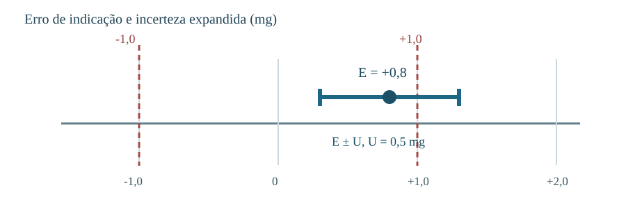
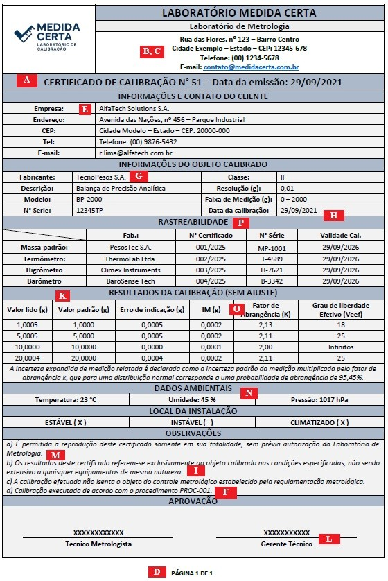

{fig-alt="Ilustração de um certificado de calibração sendo analisado com lupa, símbolos de medição, verificação e alerta."}

Na engenharia e na qualidade, a confiabilidade das medições é fundamental. Um produto pode ser aprovado ou rejeitado, um processo pode ser liberado ou interrompido e até decisões financeiras podem depender de um simples resultado de medição.

Por isso, **certificados de calibração não devem ser encarados apenas como documentos burocráticos** para atender a normas e requisitos. Eles fornecem informações importantes para verificar se um instrumento continua adequado ao uso pretendido.

Mas como fazer essa análise? O que precisamos conferir no documento? E como interpretar os resultados? Vamos entender essas questões com um exemplo prático.

## O que é um certificado de calibração?

Segundo o **Vocabulário Internacional de Metrologia (VIM)**, a calibração estabelece, sob condições especificadas, uma relação entre valores de referência (com suas incertezas) e as indicações de um instrumento (também com suas incertezas). Essa relação pode ser apresentada de diferentes formas, como uma declaração, uma tabela ou uma curva de calibração.

Na prática, o **certificado de calibração** registra as informações necessárias para compreender o que foi realizado: qual instrumento foi calibrado, quais padrões foram utilizados, em que condições a calibração ocorreu e quais resultados foram encontrados.

Assim, o certificado é mais do que um papel arquivado. É uma **evidência técnica** que apoia a rastreabilidade metrológica e a confiabilidade das medições dentro de um sistema de gestão da qualidade.

Entretanto, existe uma diferença importante: **ter um certificado de calibração não significa, automaticamente, que o instrumento está aprovado para qualquer aplicação**. Para chegar a essa conclusão, é necessário avaliar seus resultados em relação aos requisitos do processo.

## O que a ISO/IEC 17025:2017 determina?

A **ABNT NBR ISO/IEC 17025:2017** apresenta requisitos para a competência de laboratórios de ensaio e calibração. Seu item **7.8 — Relato de resultados** aborda as informações que devem constar nos relatórios e certificados, incluindo requisitos específicos para calibrações.

A norma não exige que todos os certificados tenham a mesma aparência. O importante é que os resultados sejam apresentados de maneira clara, objetiva e com as informações necessárias para sua interpretação.

### O que conferir no certificado?

Ao receber um certificado, podemos seguir este roteiro de análise:

| Informação | O que verificar |
|:---|:---|
| **Identificação do documento** | Título, número ou identificação única do certificado e indicação de que o documento está completo |
| **Laboratório responsável** | Nome, endereço e local onde a calibração foi realizada |
| **Cliente** | Identificação de quem solicitou a calibração |
| **Instrumento calibrado** | Descrição, fabricante, modelo, número de série e outras informações que permitam identificá-lo |
| **Método utilizado** | Procedimento ou método empregado na calibração |
| **Datas** | Quando a calibração foi realizada e quando o certificado foi emitido |
| **Resultados e unidades** | Indicações, valores de referência, erros ou correções, conforme o método, e respectivas unidades |
| **Incerteza de medição** | Incerteza associada aos resultados e informações necessárias à sua interpretação |
| **Rastreabilidade metrológica** | Informações sobre como os resultados se relacionam a referências metrológicas |
| **Condições ambientais relevantes** | Temperatura, umidade e outras condições que tenham influência nos resultados |
| **Ajustes ou reparos** | Quando houver, resultados antes e depois dessas intervenções, se disponíveis |
| **Responsável pela emissão** | Identificação da pessoa autorizada a emitir o relatório |
| **Observações e declarações** | Restrições de uso dos resultados, reprodução do documento e declarações de conformidade, quando aplicáveis |

: Roteiro didático para conferir as informações de um certificado de calibração. {#tbl-verificacao}

Esse quadro resume pontos importantes para a análise, mas **não substitui os requisitos completos da norma**. Algumas informações dependem do tipo de calibração, das atividades executadas e do que foi acordado com o cliente.

Dois cuidados adicionais merecem atenção:

- Quando o laboratório emite uma **declaração de conformidade**, a regra de decisão utilizada precisa ser considerada, conforme os requisitos aplicáveis.
- O certificado **não deve recomendar automaticamente a data da próxima calibração**, salvo quando isso tiver sido acordado com o cliente. A definição do intervalo de calibração depende também do uso do instrumento e dos requisitos do processo.

## Como interpretar um certificado na prática?

Conferir se todos os campos estão preenchidos é apenas o primeiro passo. Depois, precisamos compreender os **resultados da calibração** e avaliar se eles são adequados à aplicação.

Um erro comum é olhar somente para o valor do erro de indicação e ignorar a **incerteza de medição**. As duas informações são importantes para tomar uma decisão de conformidade, conforme a **regra de decisão** adotada.

### Exemplo: uma balança analítica

Imagine que, para determinada aplicação, uma balança tenha um **erro máximo admissível (EMA)** de **±1,0 mg**. O resultado de sua calibração é:

| Informação | Valor |
|:---|---:|
| Erro máximo admissível (EMA) | ±1,0 mg |
| Erro de indicação ($E$) | +0,8 mg |
| Incerteza expandida ($U$) | 0,5 mg |
| Fator de abrangência ($k$) | 2 |

: Dados de um exemplo numérico ilustrativo. {#tbl-exemplo-balanca}

O erro observado, de **+0,8 mg**, está dentro dos limites de ±1,0 mg. Porém, isso ainda não basta para afirmar que a balança pode ser aceita por qualquer regra de decisão.

Uma forma de visualizar a situação é considerar o intervalo **$E\pm U$**, que, neste exemplo, vai de **+0,3 mg a +1,3 mg**. Esse intervalo ultrapassa o limite superior de +1,0 mg.

{#fig-exemplo-balanca fig-cap="Exemplo ilustrativo: erro de +0,8 mg, incerteza expandida de 0,5 mg e limites de ±1,0 mg."}

**Atenção:** o intervalo $E\pm U$ não representa limites absolutos dentro dos quais o erro verdadeiro necessariamente estará. A interpretação estatística da incerteza depende das hipóteses e do procedimento de avaliação utilizados.

Se adotarmos, por exemplo, uma **regra conservadora de aceitação**, podemos exigir:

$$
|E|+U\leq EMA.
$$

Substituindo os valores:

$$
0{,}8+0{,}5=1{,}3\ \mathrm{mg}>1{,}0\ \mathrm{mg}.
$$

Nesse caso, **não é possível declarar a conformidade pela regra conservadora escolhida**, mesmo que o erro nominal esteja dentro do EMA.

Isso não significa que toda regra levará à mesma decisão: o critério de aceitação depende dos requisitos aplicáveis e do risco de aceitar ou rejeitar incorretamente um instrumento. Em alguns casos, a decisão poderá ser inconclusiva.

O **EMA** é o limite de erro permitido para determinada aplicação. Esse limite pode decorrer de requisitos regulamentares, especificações ou necessidades do processo de medição. Por isso, não existe um único EMA que sirva para todos os instrumentos e usos.

## Exemplo ilustrativo: analisando um certificado

A @fig-certificado apresenta um **certificado fictício de calibração de uma balança analítica**, emitido pelo laboratório fictício *Medida Certa*. O documento foi preparado exclusivamente para fins didáticos.

{#fig-certificado width="560px" fig-align="center" fig-cap="Certificado fictício de calibração, com marcações que destacam informações a serem verificadas durante a análise crítica."}

[Abrir a imagem do certificado em tamanho original](images/certificado-ficticio-original.jpg).

As **letras em vermelho da @fig-certificado** funcionam como um roteiro de leitura. Localize cada marcação na imagem e utilize a @tbl-marcacoes-certificado para identificar a informação correspondente e entender por que ela deve ser verificada.

| Marcação | Onde olhar no certificado | O que conferir? |
|:---:|:---|:---|
| **A** | Título e número do certificado | Identificar o documento e seu número, neste exemplo, **Certificado nº 51**. |
| **B** | Nome do laboratório | Conferir quem realizou a calibração: **Laboratório Medida Certa**, fictício. |
| **C** | Endereço e dados de contato do laboratório | Verificar a identificação e os dados do laboratório emissor. |
| **D** | Rodapé — **página 1 de 1** | Conferir a identificação do final e se todas as páginas do certificado estão presentes. |
| **E** | Informações do cliente | Verificar para quem o certificado foi emitido, neste caso, **AlfaTech Solutions S.A.** (fictícia). |
| **F** | Observações — procedimento **PROC-001** | Identificar o procedimento de calibração utilizado. |
| **G** | Informações do objeto calibrado | Conferir descrição, fabricante, modelo e número de série da balança, comparando-os com o equipamento real. |
| **H** | Data da calibração — **29/09/2021** | Distinguir a data em que a calibração foi realizada da data de emissão do documento. |
| **I** | Observação sobre a aplicação dos resultados | Confirmar que os resultados se referem somente ao objeto calibrado. |
| **K** | Resultados da calibração | Examinar os valores indicados, os valores de referência e os erros de indicação, com suas unidades. |
| **L** | Campo de aprovação | Verificar a identificação e a autorização do responsável pela emissão. |
| **M** | Observação sobre a reprodução | Conferir a orientação para reprodução integral do certificado, preservando seu contexto. |
| **N** | Dados ambientais | Identificar as condições registradas, como **23 °C** e **45% de umidade relativa**. |
| **O** | Fator de abrangência **(k)** | Verificar o fator utilizado para expressar a incerteza expandida; a incerteza indicada está na coluna **IM (g)** da tabela de resultados. |
| **P** | Rastreabilidade | Identificar os padrões e instrumentos de referência e os dados dos respectivos certificados. |

: Correspondência das marcações vermelhas da @fig-certificado com os campos do certificado fictício. {#tbl-marcacoes-certificado tbl-colwidths="[12,33,55]"}

Por exemplo, para examinar um resultado, comece pela marcação **K** e confira o erro de indicação e a unidade. Depois, observe a incerteza na coluna **IM (g)** e o fator de abrangência apontado pela marcação **O**. Compare essas informações com o erro máximo admissível da sua aplicação e aplique a regra de decisão apropriada. **O certificado não determina, sozinho, se a balança está conforme.**

As marcações são **didáticas** e não correspondem à numeração oficial dos requisitos da ISO/IEC 17025. A identificação dos padrões na marcação **P**, por exemplo, ajuda na análise documental, mas não dispensa a avaliação das informações de rastreabilidade necessárias.

Os dados do certificado são fictícios e **não correspondem aos valores do exemplo numérico da balança apresentado na seção anterior**.

### O certificado garante que o instrumento está adequado?

**Não necessariamente.** O certificado informa os resultados obtidos durante a calibração, sob condições específicas. Cabe ao usuário avaliar se esses resultados atendem aos requisitos de seu processo.

A partir das informações sobre erro de indicação, incerteza, rastreabilidade e outros aspectos, podemos decidir se o instrumento continuará em uso ou se precisará ser ajustado, reparado ou substituído.

Em outras palavras, **um instrumento calibrado não é, automaticamente, um instrumento adequado ao processo**.

## Conclusão

Realizar a análise crítica de certificados de calibração é uma competência importante para quem atua em engenharia, metrologia e qualidade.

Mais do que conferir se o documento existe, é preciso **interpretar seus resultados** e compará-los com os requisitos da aplicação. Quando bem compreendido, o certificado deixa de ser apenas um anexo burocrático e se torna uma ferramenta para apoiar decisões técnicas, auditorias, rastreabilidade e a melhoria contínua dos processos de medição.

## Referências

- **ABNT NBR ISO/IEC 17025:2017.** Requisitos gerais para a competência de laboratórios de ensaio e calibração.
- **JCGM 200:2012.** *Vocabulário Internacional de Metrologia (VIM)*, 1ª edição luso-brasileira (2012). [Definição de calibração no VIM](https://jcgm.bipm.org/vim/en/2.39.html).
- **Williams, A.; Magnusson, B. (eds.).** *Eurachem/CITAC Guide: Use of uncertainty information in compliance assessment*. 2ª edição, 2021. [Publicação oficial](https://www.eurachem.org/index.php/publications/guides/uncertcompliance).
- **JCGM 100:2008.** *Evaluation of measurement data — Guide to the expression of uncertainty in measurement (GUM)*. [Publicações JCGM](https://www.bipm.org/en/committees/jc/jcgm/publications).
- **Mendes, A.; Rosário, P. P. N.** *Metrologia e Incerteza de Medição: Conceitos e Aplicações*. LTC, 2019.

## Leia mais

- [Exatidão x Precisão: Qual a Diferença e Por Que Importa na Medição?](../exatidao-e-precisao/)
- [Estimativa de Incerteza em Regressões Lineares: Um Guia Prático com Python](../incerteza-regressao-linear-python/)
