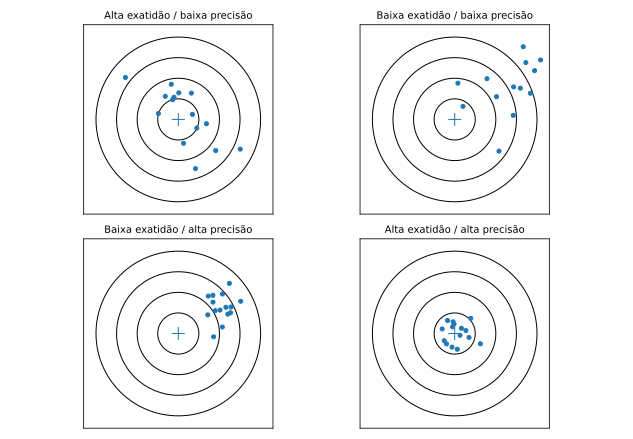

> **Sobre esta edição:** adaptação para leitura no site acadêmico de um artigo autoral publicado originalmente no [LinkedIn](https://www.linkedin.com/pulse/exatid%C3%A3o-x-precis%C3%A3o-qual-diferen%C3%A7a-e-por-que-importa-na-ruan-mayworm-b4rxf/) em 2025-03-11. A estrutura temática e os exemplos principais foram preservados, com redação editada para a web e ilustrações técnicas novas. As imagens originais do LinkedIn não foram reutilizadas por não terem sido recuperadas em qualidade verificável. As notas técnicas adicionais são identificadas como esclarecimentos desta edição.

{#fig-alvos fig-cap="Quatro combinações didáticas de exatidão e precisão. Esquema original, baseado na analogia apresentada no artigo do LinkedIn."}

Uma medição pode apresentar resultados muito próximos entre si e, ainda assim, manter um erro sistemático relevante. Essa distinção é central para compreender **exatidão** e **precisão**, conceitos relacionados, mas não equivalentes.

## O que é exatidão?

Conforme o VIM, a exatidão se refere à concordância entre um valor medido e um valor verdadeiro do mensurando. Trata-se de uma **propriedade qualitativa**: não é uma grandeza a que se atribua diretamente um valor numérico. Na prática, o erro de medição pode informar a avaliação de exatidão.

Um exemplo do artigo original considera uma balança que indica \(99{,}98\,\mathrm{g}\) para uma massa de referência de \(100{,}00\,\mathrm{g}\). Adotando esse valor de referência, o erro de indicação é

\[
E = x_{\mathrm{ind}} - x_{\mathrm{ref}} = -0{,}02\,\mathrm{g}.
\]

Se esse erro é aceitável depende da aplicação, do erro máximo admissível e da incerteza de medição.

## O que é precisão?

A precisão descreve a concordância entre indicações ou valores obtidos em **medições repetidas sob condições especificadas**. Costuma ser avaliada por medidas de dispersão, como desvio-padrão de repetibilidade ou de precisão intermediária.

No exemplo do artigo, três medições do diâmetro de uma peça fornecem \(15{,}23\), \(15{,}24\) e \(15{,}22\,\mathrm{mm}\). Os valores apresentam pequena dispersão, mas não é possível concluir sobre exatidão sem uma referência adequada.

O desvio-padrão amostral pode ser calculado por

\[
s=\sqrt{\frac{\sum_{i=1}^{n}(x_i-\bar{x})^2}{n-1}}.
\]

Para esses três resultados, \(\bar{x}=15{,}23\,\mathrm{mm}\) e \(s=0{,}01\,\mathrm{mm}\).

## Visualizando as combinações

A analogia com um alvo de tiro permite distinguir quatro situações:

- **Alta exatidão e baixa precisão:** valores dispersos em torno do centro.
- **Baixa exatidão e baixa precisão:** valores dispersos e deslocados do centro.
- **Baixa exatidão e alta precisão:** resultados agrupados, porém afastados do centro.
- **Alta exatidão e alta precisão:** resultados agrupados próximos ao centro.

A comparação visual é didática. Na prática, a exatidão requer referência metrológica, e a precisão depende das condições em que as repetições foram realizadas.

## Aplicações em engenharia e qualidade

Uma série com baixa dispersão pode sugerir boa repetibilidade, mas apresentar **tendência** (viés). Do mesmo modo, a média de resultados muito dispersos pode coincidir com o valor de referência sem que o processo de medição seja satisfatório. Por isso, é importante distinguir avaliação de erro sistemático, dispersão e incerteza de medição.

## Conclusão

Exatidão e precisão não são sinônimos. A compreensão conjunta dessas propriedades, associada à avaliação da incerteza, permite fundamentar melhor decisões envolvendo instrumentos, medições e tolerâncias.

## Referências indicadas no artigo original

- JCGM 200:2012 — Vocabulário Internacional de Metrologia (VIM).
- BIPM — Sistema Internacional de Unidades (SI), 9ª edição.
- JCGM 100:2008 — Guia para expressão de incerteza de medição.
