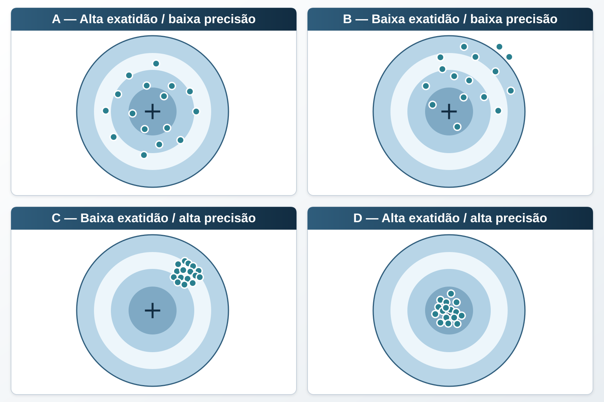

Ao medir qualquer grandeza, seja a temperatura, a pressão ou as dimensões de uma peça mecânica, dois conceitos fundamentais surgem: **exatidão** e **precisão**. Apesar de serem frequentemente confundidos, eles têm significados diferentes e influenciam diretamente a confiabilidade dos resultados.

Para entender a diferença, vamos recorrer a exemplos simples e, depois, mostrar como esses conceitos podem ser avaliados por meio de cálculos.

## O que é exatidão?

**Exatidão é a proximidade de um valor medido em relação ao valor verdadeiro da grandeza que estamos medindo.** Quanto menor o erro de medição, mais exata é considerada a medição.

De acordo com o **Vocabulário Internacional de Metrologia (VIM)**, a exatidão de medição está relacionada ao grau de concordância entre um valor medido e um valor verdadeiro do mensurando.

O VIM também esclarece algo importante: **a exatidão não é uma grandeza e, portanto, não pode ser expressa diretamente por um número**. O erro de medição pode, entretanto, ajudar a avaliar essa proximidade.

### Exemplo de exatidão

Imagine um termômetro corretamente calibrado que indique **37,2 °C** quando medimos a temperatura corporal de uma pessoa. Se a temperatura de referência fosse exatamente **37,2 °C**, essa medição apresentaria erro nulo em relação ao valor considerado.

Outro exemplo é uma balança utilizada em um laboratório farmacêutico. Se uma substância tem massa de referência de **100,00 g**, mas a balança indica **99,98 g**, a diferença é de **−0,02 g**. O valor absoluto do erro é **0,02 g**.

Dependendo da tolerância do processo e da incerteza de medição, esse erro pode ser considerado pequeno e adequado para a aplicação.

A exatidão de uma medição pode ser afetada por fatores como a calibração, a deriva do instrumento ao longo do tempo e as características do sensor. Quando os erros não são adequadamente avaliados, as decisões tomadas com base nos resultados podem ser comprometidas.

## O que é precisão?

**Precisão é o grau de concordância entre resultados de medições repetidas, realizadas sob condições especificadas.**

Em palavras mais simples, quando medimos várias vezes a mesma grandeza, a precisão nos ajuda a entender **o quanto os resultados ficam próximos uns dos outros**. Quanto menor a dispersão das leituras, maior a precisão observada nas condições consideradas.

Segundo o VIM, a precisão está relacionada à concordância entre indicações ou valores medidos obtidos em medições repetidas sob condições definidas. Dependendo dessas condições, podemos avaliar, por exemplo, a repetibilidade ou a reprodutibilidade.

### Exemplo de precisão

Imagine que medimos o diâmetro de uma peça metálica três vezes com um paquímetro e obtemos:

- **15,23 mm**
- **15,24 mm**
- **15,22 mm**

Os valores são bastante próximos entre si. Isso indica **boa precisão** nas condições dessa pequena série de medições.

Entretanto, ainda não sabemos se o valor do diâmetro está correto: para avaliar a **exatidão**, precisaríamos compará-lo com um valor de referência adequado.

A precisão pode ser comprometida por fatores como ruído eletrônico, variações ambientais, instabilidade do operador ou mudanças no procedimento de medição. Por isso, é importante registrar e controlar as condições em que as medições são feitas.

## Como quantificar exatidão e precisão?

Embora a exatidão não seja expressa diretamente por um número, podemos **avaliar o erro de medição** comparando o resultado com um valor de referência.

### Erro de medição

No artigo, utilizamos a seguinte expressão:

$$
E=X-VVC
$$

Onde:

- $E$ = erro de medição;
- $X$ = valor medido;
- $VVC$ = valor verdadeiro convencional, terminologia tradicional para um valor convencional utilizado como referência.

*Observação:* na terminologia atual do VIM, é preferível utilizar **valor de referência** ou **valor convencional da grandeza**, conforme o contexto. A ideia do cálculo permanece a mesma: **erro = valor medido − valor de referência**.

Retomando o exemplo da balança:

$$
E=99{,}98-100{,}00=-0{,}02\ \mathrm{g}.
$$

O sinal negativo indica que a balança apresentou um valor **abaixo** da referência. Já o módulo do erro, $|E|=0{,}02\ \mathrm{g}$, indica o tamanho dessa diferença.

### Dispersão das medições

A precisão pode ser avaliada pela dispersão dos resultados. O **desvio-padrão** e a **variância** são algumas das medidas estatísticas mais utilizadas para isso.

Uma expressão descritiva para o desvio-padrão de um conjunto completo de $n$ valores é:

$$
\sigma=\sqrt{\frac{\sum_{i=1}^{n}(X_i-X_m)^2}{n}}
$$

Onde:

- $\sigma$ = desvio-padrão dos valores considerados;
- $X_i$ = cada valor individual medido;
- $X_m$ = média dos valores medidos;
- $n$ = número de medições.

**Quanto menor o desvio-padrão, menor é a dispersão dos resultados.** Assim, podemos identificar se as medições se mantêm próximas umas das outras.

**Um detalhe importante:** quando temos apenas uma *amostra* de resultados e queremos estimar o desvio-padrão do processo de medição, é usual empregar o **desvio-padrão amostral**, com $n-1$ no denominador:

$$
s=\sqrt{\frac{\sum_{i=1}^{n}(X_i-\bar X)^2}{n-1}}.
$$

No exemplo do paquímetro, a média das três leituras é **15,23 mm** e o desvio-padrão amostral é **0,01 mm**. Esse cálculo descreve a dispersão observada; ele, isoladamente, não informa se a medição está próxima do valor verdadeiro.

## Exatidão e precisão na prática

Podemos visualizar melhor a diferença entre esses conceitos por meio de uma analogia com um **alvo de tiro**.

Imagine que o centro do alvo representa o valor que desejamos medir. Cada marca representa um resultado obtido. A posição das marcas em relação ao centro e a distância entre elas ajudam a entender quatro situações diferentes.

{#fig-alvos fig-cap="Figura 1 — Quatro combinações ilustrativas de exatidão e precisão. A cruz representa a referência e os pontos representam medições repetidas. A analogia não substitui uma avaliação metrológica."}

As situações da @fig-alvos representam:

- **A — Alta exatidão e baixa precisão:** os resultados ficam dispersos, mas, no conjunto, estão próximos do centro do alvo.
- **B — Baixa exatidão e baixa precisão:** os resultados estão espalhados e, em geral, afastados do centro, sem um agrupamento definido.
- **C — Alta precisão e baixa exatidão:** os resultados estão bem agrupados, mas longe do centro do alvo.
- **D — Alta exatidão e alta precisão:** os resultados estão agrupados e próximos do centro do alvo.

Observe que é possível obter resultados muito semelhantes entre si e, ainda assim, estar longe do valor correto. Também é possível ter resultados dispersos cuja média fique próxima do valor de referência.

Essa analogia ajuda a entender por que **exatidão e precisão não são sinônimos** e por que ambos os conceitos são importantes em metrologia, controle da qualidade e experimentos científicos.

## Por que isso importa?

Em processos industriais e laboratórios, exatidão e precisão influenciam diretamente a qualidade dos produtos e a confiança que podemos ter nos resultados de medição. Os instrumentos precisam ser adequados ao uso e **calibrados em intervalos definidos conforme a aplicação e os riscos envolvidos**.

Alguns exemplos mostram a importância desses conceitos:

- **Indústria farmacêutica:** medições confiáveis ajudam a controlar a dosagem de medicamentos.
- **Engenharia:** resultados de medição adequados contribuem para que estruturas e componentes sejam fabricados dentro das especificações.
- **Comércio:** balanças confiáveis favorecem transações justas e reduzem erros nas quantidades comercializadas.
- **Meteorologia:** medições de temperatura, pressão e outras grandezas são fundamentais para acompanhar e prever condições atmosféricas.

Em todas essas situações, avaliar apenas se as leituras se repetem não é suficiente. Também precisamos saber se os resultados estão próximos dos valores de referência e **qual é a incerteza associada às medições**.

## Conclusão

Tanto a exatidão quanto a precisão são importantes, mas compreender suas diferenças evita interpretações equivocadas dos resultados.

Um instrumento pode fornecer medições **precisas, mas pouco exatas**, ou medições **pouco precisas, mas próximas do valor de referência em média**. O cenário desejável é aquele em que os resultados apresentam boa precisão e exatidão adequada à finalidade da medição.

Por fim, a avaliação da **incerteza de medição** complementa essa análise e ajuda a determinar se os resultados são suficientemente confiáveis para a decisão que precisamos tomar.

## Referências e fontes

- **JCGM 200:2012.** *International Vocabulary of Metrology — Basic and general concepts and associated terms (VIM)*, 3ª edição. [DOI: 10.59161/JCGM200-2012](https://doi.org/10.59161/JCGM200-2012). Definições: [exatidão](https://jcgm.bipm.org/vim/en/2.13.html), [precisão](https://jcgm.bipm.org/vim/en/2.15.html) e [erro de medição](https://jcgm.bipm.org/vim/en/2.16.html).

- **BIPM.** *The International System of Units (SI)*, 9ª edição (2019, atualizada em 2026). [DOI: 10.59161/AUEZ1291](https://doi.org/10.59161/AUEZ1291).

- **JCGM 100:2008(E).** *Evaluation of measurement data — Guide to the expression of uncertainty in measurement (GUM).* [DOI: 10.59161/JCGM100-2008E](https://doi.org/10.59161/JCGM100-2008E).

- **Mendes, A.; Rosário, P. P.** *Metrologia e Incerteza de Medição — Conceitos e Aplicações*. 1ª edição. LTC, 2020. ISBN 9788521636755.

## Leia mais

- [A fascinante jornada da Metrologia: da antiguidade aos dias atuais](../a-fascinante-jornada-da-metrologia/index.qmd)
- [Análise Crítica de Certificados de Calibração: um guia prático](../analise-critica-certificados-calibracao/index.qmd)
- **Exatidão x Precisão: Qual a Diferença e Por Que Importa na Medição?** *(este artigo)*
- [Estimativa de Incerteza em Regressões Lineares: Um Guia Prático com Python](../incerteza-regressao-linear-python/index.qmd)
- [Como Determinar os Intervalos Entre Calibrações dos Equipamentos de Medição](../intervalos-entre-calibracoes/index.qmd)
