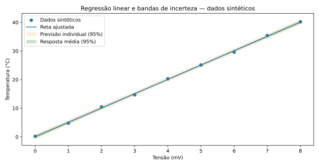

> **Sobre esta edição:** adaptação para leitura no site acadêmico de um artigo autoral publicado originalmente no [LinkedIn](https://www.linkedin.com/pulse/estimativa-de-incerteza-em-regress%C3%B5es-lineares-um-guia-ruan-mayworm-oceuf/) em 2025-03-26. A estrutura temática e os exemplos principais foram preservados, com redação editada para a web e ilustrações técnicas novas. As imagens originais do LinkedIn não foram reutilizadas por não terem sido recuperadas em qualidade verificável. As notas técnicas adicionais são identificadas como esclarecimentos desta edição.

{#fig-regressao fig-cap="Dados sintéticos: regressão linear com faixa de confiança da resposta média e faixa de previsão individual. Ilustração criada para esta edição, não reconstituição do experimento original."}

A regressão linear é frequentemente utilizada em curvas de calibração, relacionando a indicação de um instrumento com valores de referência. A equação ajustada descreve a relação estimada; para utilizá-la metrologicamente, é necessário também avaliar **a incerteza dos coeficientes** e **a incerteza dos valores calculados**.

## Mínimos quadrados ordinários

Para \(n\) pares de dados \((x_i,y_i)\), considere o modelo

\[
y_i = \beta_0 + \beta_1 x_i + \varepsilon_i,\]

em que \(\beta_0\) é o intercepto, \(\beta_1\) a inclinação e \(\varepsilon_i\) o erro aleatório. Com a matriz de projeto \(X=[\mathbf{1}\ \mathbf{x}]\), a estimativa de mínimos quadrados é

\[
\hat{\boldsymbol\beta}=(X^\mathsf{T}X)^{-1}X^\mathsf{T}\mathbf{y}.
\]

A expressão pressupõe posto completo. Na implementação numérica, é preferível resolver o problema via `numpy.linalg.lstsq`, em vez de inverter explicitamente a matriz normal.

## Variância residual e covariância dos parâmetros

Assumindo erros independentes, homoscedásticos, com média zero e variância comum, a variância residual estimada é

\[
s^2=\frac{\sum_{i=1}^{n}(y_i-\hat y_i)^2}{n-2},
\qquad
C_{\hat\beta}=s^2(X^\mathsf{T}X)^{-1}.
\]

As raízes quadradas dos elementos diagonais de \(C_{\hat\beta}\) são os erros-padrão do intercepto e da inclinação. O termo fora da diagonal representa a **covariância** entre eles e deve ser mantido na propagação.

Para o valor médio estimado \(\hat y(x_0)=\hat\beta_0+\hat\beta_1x_0\), a incerteza padrão associada aos coeficientes é

\[
u\!\left[\hat y(x_0)\right]=\sqrt{\begin{bmatrix}1&x_0\end{bmatrix}
C_{\hat\beta}
\begin{bmatrix}1\\x_0\end{bmatrix}}.
\]

A previsão de **uma nova observação individual** requer contabilizar também a dispersão residual, além da incerteza da média ajustada. A análise metrológica de uma curva real pode exigir ainda incertezas dos padrões, dos valores de \(x\), correlações e termos do tipo B — não contemplados automaticamente pelo modelo simples de mínimos quadrados ordinários.

## Exemplo computacional reproduzível (dados sintéticos)

O artigo original apresenta um caso de calibração de termopar e reporta os indicadores \(R^2=0{,}9984\) e RMSE de aproximadamente \(0{,}7062\,{}^\circ\mathrm C\). A tabela de dados experimentais e os gráficos originais não foram recuperados integralmente; por isso, o exemplo abaixo utiliza **dados sintéticos independentes**, não reproduz nem valida aqueles resultados.

```{.python}
import numpy as np
from scipy.stats import t

# Dados sintéticos de tensão (mV) e temperatura (°C)
x = np.array([0., 1., 2., 3., 4., 5., 6., 7., 8.])
y = np.array([0.2, 4.8, 10.5, 14.7, 20.3, 25.1, 29.6, 35.4, 40.2])

X = np.column_stack((np.ones_like(x), x))
beta, *_ = np.linalg.lstsq(X, y, rcond=None)
residuos = y - X @ beta
n, p = X.shape
s2 = np.sum(residuos**2) / (n - p)
C_beta = s2 * np.linalg.inv(X.T @ X)

x0 = np.array([0., 2., 4., 6., 8.])
H = np.column_stack((np.ones_like(x0), x0))
y0 = H @ beta
u_media = np.sqrt(np.einsum('ij,jk,ik->i', H, C_beta, H))
u_previsao = np.sqrt(u_media**2 + s2)
k95 = t.ppf(0.975, df=n-p)

print('Intercepto e inclinação:', beta)
print('Incerteza expandida da resposta média:', k95 * u_media)
print('Semi-amplitude do intervalo de previsão:', k95 * u_previsao)
```

**Dependências:** Python 3, NumPy e SciPy. As fórmulas de abrangência com Student consideram as hipóteses estatísticas indicadas e não incluem automaticamente outras contribuições metrológicas.

## Avaliação do ajuste

Além do coeficiente \(R^2\), examine os **resíduos** para verificar curvatura, heteroscedasticidade e valores influentes. Uma correlação aparente elevada não é suficiente para comprovar adequação do modelo. O erro-padrão residual \(s\) quantifica dispersão dos resíduos; não deve ser confundido com erro absoluto médio (MAE).

A faixa da resposta média tende a ser mais estreita em torno da média de \(x\), aumentando nas extremidades do intervalo. Isso reflete a geometria do ajuste, **não significa que os resíduos individuais aumentem necessariamente nas extremidades**.

## Conclusão

A regressão linear oferece uma ferramenta útil para calibração, desde que a interpretação inclua os coeficientes, suas covariâncias, o comportamento dos resíduos e as fontes adicionais de incerteza relevantes para a aplicação.

## Referências indicadas no artigo original

- JCGM 100:2008 — *Guide to the Expression of Uncertainty in Measurement*.
- Artigo original no LinkedIn, com a aplicação em termopar e código de cálculo.
