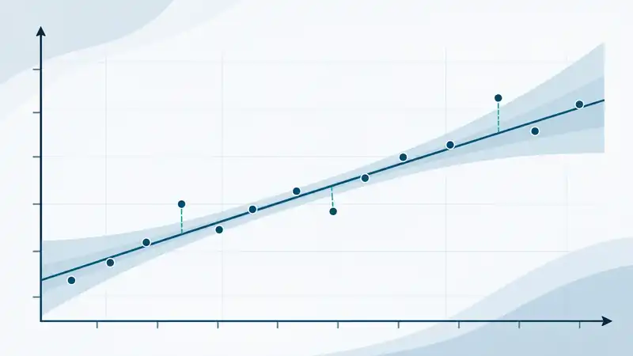
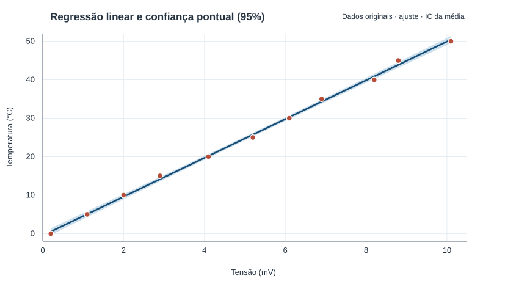
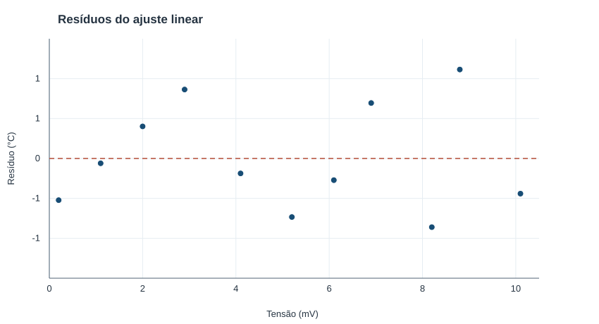
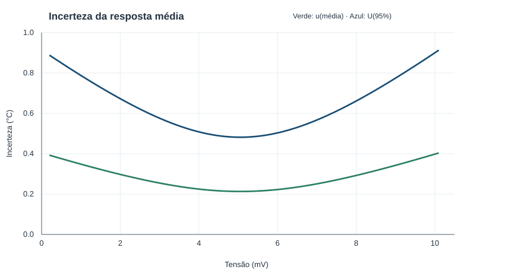

A análise de regressão é uma ferramenta fundamental para modelar relações entre variáveis, sendo amplamente utilizada em engenharia, ciências e finanças. No entanto, além de simplesmente ajustar um modelo, é essencial quantificar a incerteza das previsões, garantindo maior confiabilidade nas estimativas.

Este artigo explica como calcular a incerteza em regressões lineares, abordando conceitos teóricos essenciais e apresentando um exemplo prático utilizando **Python**.

## Método dos mínimos quadrados

O **método dos mínimos quadrados** é utilizado para determinar a linha que melhor se ajusta a um conjunto de dados. Ele também é muito empregado na determinação de **curvas de calibração**, utilizando cálculos e conceitos de álgebra linear.

Em uma análise de regressão, começamos com $n$ pares de observações, representados por $(x_i,y_i)$. Quando queremos representar os dados por um polinômio de grau $m$, podemos utilizar a expressão:

$$
y_i=\beta_0+\sum_{j=1}^{m}\beta_j x_i^j+\varepsilon_i.
$$

Nessa equação, os coeficientes $\beta_j$ são os parâmetros que queremos determinar, enquanto $\varepsilon_i$ representa a diferença entre o valor observado e o valor descrito pelo modelo.

O conjunto de equações também pode ser representado na forma matricial:

$$
\begin{bmatrix}
y_1\\y_2\\\vdots\\y_n
\end{bmatrix}
=
\begin{bmatrix}
1&x_1&x_1^2&\cdots&x_1^m\\
1&x_2&x_2^2&\cdots&x_2^m\\
\vdots&\vdots&\vdots&&\vdots\\
1&x_n&x_n^2&\cdots&x_n^m
\end{bmatrix}
\begin{bmatrix}
\beta_0\\\beta_1\\\vdots\\\beta_m
\end{bmatrix}
+
\begin{bmatrix}
\varepsilon_1\\\varepsilon_2\\\vdots\\\varepsilon_n
\end{bmatrix}.
$$

Resolvendo o problema de mínimos quadrados, é possível calcular os coeficientes $\beta_j$. Quando utilizamos apenas uma reta, ou seja, uma **regressão linear de primeira ordem**, a equação assume uma forma mais simples:

$$
y=\beta_0+\beta_1x+\varepsilon.
$$

Nesse caso, $\beta_0$ representa o **intercepto** (valor em que a reta cruza o eixo vertical), e $\beta_1$ representa a **inclinação** (quanto $y$ varia quando $x$ aumenta uma unidade).

### Matriz de covariância dos coeficientes

Depois de encontrar a melhor reta, surge uma pergunta: **qual é a incerteza dos coeficientes que calculamos?**

As incertezas das estimativas dos parâmetros podem ser obtidas pela **matriz de covariância $C$** dos coeficientes $\beta_j$. A diagonal principal contém as variâncias individuais dos coeficientes. A raiz quadrada desses valores fornece as **incertezas-padrão** de $\beta_0$ e $\beta_1$.

Para o ajuste por mínimos quadrados ordinários, a matriz de covariância estimada é dada por:

$$
C=s^2(X^\mathsf{T}X)^{-1}.
$$

Nessa expressão, $X$ é a matriz com os dados da regressão e $s^2$ é a **variância residual**, calculada por:

$$
s^2=\frac{\sum_{i=1}^{n}(y_i-\hat y_i)^2}{n-p}.
$$

Onde:

- $y_i$ são os valores observados;
- $\hat y_i$ são os valores calculados pela regressão;
- $n$ é o número de observações;
- $p$ é o número de parâmetros ajustados (para uma reta, $p=2$: intercepto e inclinação).

A matriz de covariância nos ajuda a entender o quanto podemos confiar nos coeficientes estimados. Ela é **simétrica**: a covariância entre dois coeficientes é a mesma independentemente da ordem em que são considerados.

Na diagonal principal, encontramos as variâncias dos coeficientes. Já os elementos fora da diagonal mostram como os coeficientes variam em conjunto. Essa informação é importante porque, ao calcular a incerteza da reta, **não devemos ignorar a covariância entre o intercepto e a inclinação**.

Para uma regressão linear, a matriz tem a seguinte forma:

$$
C=
\begin{bmatrix}
s_{00}&s_{01}\\
s_{01}&s_{11}
\end{bmatrix},
$$

em que $s_{00}$ é a variância do intercepto, $s_{11}$ é a variância da inclinação e $s_{01}$ é a covariância entre ambos.

*Observação:* uma covariância elevada não indica, por si só, que existe um problema de multicolinearidade. A correlação entre o intercepto e a inclinação pode ocorrer naturalmente, dependendo dos valores de $x$.

## Como estimar a incerteza da regressão linear?

O **Guia para a Expressão da Incerteza de Medição (JCGM 100)** apresenta regras gerais para avaliar e expressar incertezas. Quando conhecemos o modelo matemático que relaciona as grandezas, podemos utilizar a lei de propagação de incertezas:

$$
u_c^2(y)=
\sum_{i=1}^{q}
\left(\frac{\partial f}{\partial x_i}\right)^2u^2(x_i)
+
2\sum_{i=1}^{q-1}\sum_{j=i+1}^{q}
\frac{\partial f}{\partial x_i}
\frac{\partial f}{\partial x_j}
u(x_i,x_j).
$$

Os termos $u(x_i)$ representam as incertezas-padrão das grandezas de entrada, enquanto $u(x_i,x_j)$ representa a covariância entre duas delas.

Para entender a aplicação dessa fórmula na regressão linear, vamos utilizar o modelo:

$$
\hat y=\hat\beta_0+\hat\beta_1x.
$$

Considerando um valor de $x$ conhecido, calculamos as derivadas parciais em relação aos dois coeficientes:

$$
\frac{\partial\hat y}{\partial\hat\beta_0}=1,
\qquad
\frac{\partial\hat y}{\partial\hat\beta_1}=x.
$$

Substituindo essas derivadas na equação de propagação, obtemos:

$$
\boxed{
u_A^2(x)=s_{00}+x^2s_{11}+2xs_{01}
}.
$$

Essa é uma das equações mais importantes deste exemplo. Ela permite calcular a **incerteza-padrão da resposta média estimada** pela reta, considerando as incertezas e a covariância dos coeficientes.

Caso existam outras contribuições relevantes de incerteza, como aquelas associadas ao padrão de referência, elas também devem ser avaliadas. Para contribuições **independentes** e já expressas na unidade da saída, podemos escrever, de forma simplificada:

$$
u_c=\sqrt{u_A^2+u_B^2}.
$$

Vale destacar uma diferença importante: **estimar a temperatura média indicada pela reta não é a mesma coisa que prever uma nova medição individual**. No segundo caso, precisamos levar em conta também a dispersão residual dos resultados:

$$
u_{\mathrm{pred}}(x)=\sqrt{u_A^2(x)+s^2}.
$$

Nosso exemplo terá como foco a incerteza associada à **resposta média da regressão**, calculada a partir dos coeficientes $\beta_0$ e $\beta_1$.

Por fim, a **incerteza expandida** é obtida multiplicando a incerteza-padrão pelo fator de abrangência $k$:

$$
U(x)=k\,u_c(x).
$$

Para os intervalos de confiança pontuais de 95% utilizados neste exemplo, o fator $k$ é obtido pela distribuição **t de Student**, com $n-p$ graus de liberdade. Essa escolha pressupõe as condições estatísticas usuais do ajuste linear.

## Exemplo prático: calibração de termopar

Vamos aplicar esses conceitos a um exemplo de calibração de termopar. Considere um termopar comparado com um termômetro de referência. As temperaturas são avaliadas em diferentes pontos, e queremos ajustar uma regressão linear para descrever a relação entre a **tensão (mV)** e a **temperatura (°C)**.

A @tbl-calibracao apresenta os dados utilizados no exemplo.

::: {.tabela-calibracao}

| Tensão (mV) | Temperatura (°C) |
|:-----------:|:----------------:|
| 0,20 | 0,00 |
| 1,10 | 5,00 |
| 2,00 | 10,00 |
| 2,90 | 15,00 |
| 4,10 | 20,00 |
| 5,20 | 25,00 |
| 6,10 | 30,00 |
| 6,90 | 35,00 |
| 8,20 | 40,00 |
| 8,80 | 45,00 |
| 10,10 | 50,00 |

: Dados da calibração. {#tbl-calibracao}

:::

### Automatizando os cálculos com Python

Para facilitar os cálculos, vamos criar uma função chamada `incerteza_regressao_linear`. Ela recebe os valores de tensão (eixo $x$) e de temperatura (eixo $y$), ajusta a reta e calcula a incerteza da resposta média.

O código utiliza as bibliotecas **NumPy** e **SciPy**. Para melhorar a estabilidade numérica, a reta é ajustada com `numpy.linalg.lstsq`, em vez de inverter diretamente a matriz dos mínimos quadrados.

~~~python
import numpy as np
from scipy.stats import t

def incerteza_regressao_linear(X, Y):
    """Ajusta uma reta e calcula a incerteza da resposta média."""
    X = np.asarray(X, dtype=float)
    Y = np.asarray(Y, dtype=float)
    N_OBS = len(X)
    N_PAR = 2  # Intercepto e inclinação

    # Matriz de regressão e coeficientes da reta
    M = np.column_stack([np.ones(N_OBS), X])
    P, _, posto, _ = np.linalg.lstsq(M, Y, rcond=None)
    if posto != 2:
        raise ValueError("Dados insuficientes para determinar a reta.")

    # Valores ajustados e resíduos
    Y_pred = M @ P
    Residuos = Y - Y_pred
    Graus_Liberdade = N_OBS - N_PAR

    # Variância residual e matriz de covariância
    variancia = np.sum(Residuos**2) / Graus_Liberdade
    _, R = np.linalg.qr(M, mode="reduced")
    Rinv = np.linalg.solve(R, np.eye(N_PAR))
    Matriz_Cov = variancia * (Rinv @ Rinv.T)

    # Incerteza da resposta média em cada valor de tensão
    u_c = np.sqrt(
        Matriz_Cov[0, 0] + X**2 * Matriz_Cov[1, 1]
        + 2 * X * Matriz_Cov[0, 1]
    )

    # Fator de abrangência (intervalo pontual de 95%)
    k = t.ppf(0.975, Graus_Liberdade)
    Incerteza_Expandida = k * u_c

    R_2 = 1 - np.sum(Residuos**2) / np.sum((Y - Y.mean())**2)

    return {
        "Coeficientes": P,
        "R²": R_2,
        "Valores Preditos": Y_pred,
        "Resíduos": Residuos,
        "Incerteza Padrão": u_c,
        "Incerteza Expandida": Incerteza_Expandida,
        "Desvio Padrão Residual": np.sqrt(variancia),
        "Graus de Liberdade": Graus_Liberdade,
    }

tensao = np.array([0.20, 1.10, 2.00, 2.90, 4.10, 5.20,
                   6.10, 6.90, 8.20, 8.80, 10.10])
temperatura = np.arange(0., 51., 5.)
resultados = incerteza_regressao_linear(tensao, temperatura)
print(resultados)
~~~

O código calcula os coeficientes da reta, os valores previstos, os resíduos, o coeficiente de determinação $R^2$, a matriz de covariância e as incertezas. Você também pode [acessar o script completo](codigo/regressao_incerteza.py), que gera os três gráficos deste artigo.

### Resultados da calibração

Aplicando a função aos dados da tabela, obtemos:

- **Equação ajustada:** $T=5{,}0423\,V-0{,}4863$, com $T$ em °C e $V$ em mV;
- **Coeficiente de determinação:** $R^2=0{,}9984$;
- **Desvio-padrão residual:** $s=0{,}7062\ \mathrm{°C}$;
- **Incerteza-padrão da resposta média:** de aproximadamente $0{,}213$ a $0{,}404\ \mathrm{°C}$;
- **Incerteza expandida da resposta média (95%):** de aproximadamente $0{,}482$ a $0{,}913\ \mathrm{°C}$.

**Atenção à diferença entre incerteza-padrão e expandida:** o fator de abrangência calculado é $k\approx2{,}262$ (9 graus de liberdade). Por isso, a incerteza expandida é maior do que a incerteza-padrão. O valor de $0{,}7062\ \mathrm{°C}$, por sua vez, é o *desvio-padrão residual*, cujo cálculo utiliza $n-p$ no denominador; ele não deve ser confundido com o RMSE convencional, calculado com denominador $n$.

A regressão é apresentada na @fig-ajuste.

{#fig-ajuste fig-alt="Onze pontos de calibração, reta ajustada e faixa de confiança de 95%, identificados por legenda dentro do gráfico."}

## Como avaliar a qualidade do ajuste?

Para avaliar a qualidade do ajuste, foram considerados dois indicadores: o **coeficiente de determinação ($R^2$)** e o **desvio-padrão residual ($s$)**.

O coeficiente de determinação indica a proporção da variação da temperatura que o modelo consegue explicar. Valores próximos de 1 sugerem que os dados estão bem representados pela reta, mas isso **não garante**, por si só, que o modelo seja adequado.

Já o desvio-padrão residual mede o quanto os resultados observados se afastam da reta ajustada. No nosso exemplo, encontramos $s=0{,}7062\ \mathrm{°C}$. Essa dispersão pode ser importante dependendo da aplicação do termopar. O RMSE, que também pode ser utilizado para descrever os resíduos, é igual a $0{,}6388\ \mathrm{°C}$ quando calculado com divisor $n$.

Além desses indicadores, é fundamental analisar o **gráfico de resíduos**. Se observarmos padrões sistemáticos, como uma curvatura ou uma tendência, isso pode indicar que o modelo linear não está representando bem os dados.

{#fig-residuos fig-alt="Resíduos positivos e negativos distribuídos ao redor da linha horizontal de zero."}

Na @fig-residuos, os resíduos aparecem distribuídos dos dois lados da linha zero, sem uma tendência evidente. Esse é um sinal favorável ao ajuste, embora, com apenas 11 observações, não seja possível garantir todas as hipóteses estatísticas somente pela inspeção visual.

O gráfico da @fig-incerteza mostra como a incerteza da resposta média varia ao longo da faixa de tensão.

{#fig-incerteza fig-alt="Duas curvas de incerteza em função da tensão, com legenda interna distinguindo incerteza-padrão e incerteza expandida de 95%."}

Em uma regressão linear, a **incerteza da resposta média** tende a ser menor próxima da média dos pontos utilizados no ajuste e aumenta nas extremidades da faixa. Isso acontece porque a estimativa da reta depende da distribuição dos pontos de calibração.

No exemplo, a incerteza expandida é de aproximadamente **0,482 °C** na região central e pode chegar a **0,913 °C** nas extremidades. A linha verde representa a incerteza-padrão, enquanto a linha azul representa a incerteza expandida para o intervalo pontual de confiança de 95%.

Essas curvas mostram a incerteza associada aos **coeficientes da reta**. Para avaliar a incerteza completa de uma medição com o termopar, também seria necessário considerar outras contribuições relevantes, como as incertezas do sistema de referência e da tensão de entrada.

## Conclusão

A correta estimativa da incerteza em regressões lineares é fundamental para garantir maior confiabilidade às previsões e à interpretação do modelo. Ao quantificar a incerteza, podemos avaliar não apenas a qualidade do ajuste, mas também os limites associados aos valores calculados.

Essa abordagem é importante em aplicações que dependem de medições, ajudando a evitar conclusões equivocadas e a tomar decisões com base em informações mais completas. Além disso, a análise dos resíduos e da incerteza permite identificar limitações da regressão, como a necessidade de modelos mais complexos ou a influência de outras variáveis.

Seja na calibração de sensores, na análise de dados experimentais ou no controle de processos industriais, **combinar regressão linear com avaliação de incerteza** contribui para decisões técnicas mais fundamentadas.

## Referências para se aprofundar

- **NIST/SEMATECH:** [*e-Handbook of Statistical Methods*](https://www.itl.nist.gov/div898/handbook/) — explica os métodos estatísticos com exemplos práticos.
- **Miller, J. N.; Miller, J. C.:** *Statistics and Chemometrics for Analytical Chemistry* — referência para aplicações em laboratórios e análise de dados.
- **JCGM 100:2008:** [*Guide to the Expression of Uncertainty in Measurement*](https://www.bipm.org/en/committees/jc/jcgm/publications) — guia fundamental para a avaliação de incerteza de medição.
- **NumPy e SciPy:** [`numpy.linalg.lstsq`](https://numpy.org/doc/stable/reference/generated/numpy.linalg.lstsq.html) e [distribuição t de Student](https://docs.scipy.org/doc/scipy/reference/generated/scipy.stats.t.html).

**Publicação original:** [Estimativa de Incerteza em Regressões Lineares: Um Guia Prático com Python — LinkedIn (26/03/2025)](https://www.linkedin.com/pulse/estimativa-de-incerteza-em-regress%C3%B5es-lineares-um-guia-ruan-mayworm-oceuf/).
