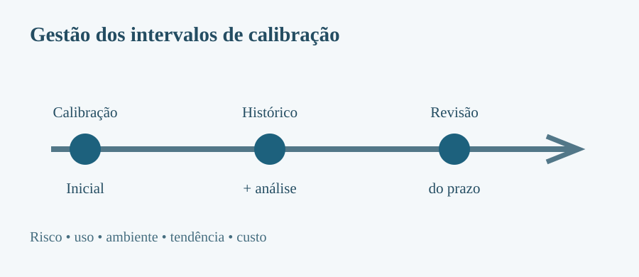
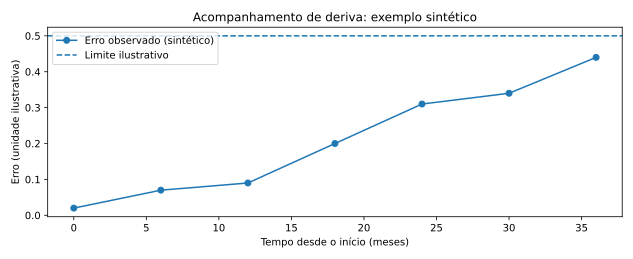

> **Sobre esta edição:** adaptação para leitura no site acadêmico de um artigo autoral publicado originalmente no [LinkedIn](https://www.linkedin.com/pulse/como-determinar-os-intervalos-entre-calibra%C3%A7%C3%B5es-dos-de-ruan-mayworm-vx4me/) em 2025-01-28. A estrutura temática e os exemplos principais foram preservados, com redação editada para a web e ilustrações técnicas novas. As imagens originais do LinkedIn não foram reutilizadas por não terem sido recuperadas em qualidade verificável. As notas técnicas adicionais são identificadas como esclarecimentos desta edição.

{fig-cap="Definição de intervalos por histórico, risco e monitoramento de desempenho. Ilustração original."}

Definir quando um equipamento deve voltar a ser calibrado envolve aspectos metrológicos, operacionais e econômicos. Um prazo fixo, aplicado indistintamente a todos os instrumentos, pode tanto aumentar custos quanto deixar passar alterações relevantes de desempenho.

## Por que revisar os intervalos

O acompanhamento periódico procura detectar deriva e instabilidade, reduzir o risco de decisões baseadas em medições inadequadas e assegurar que a informação de calibração continue suficiente para o uso pretendido. A **rastreabilidade metrológica** decorre de uma cadeia documentada de calibrações e comparações, não simplesmente da frequência escolhida.

## Fatores que influenciam a periodicidade

O artigo original destaca recomendações do fabricante, condições ambientais, frequência de uso, histórico das calibrações, criticidade da medição e incerteza requerida. A decisão deve combinar essas evidências com consequências de uma falha e condições reais de utilização.

Por exemplo, dois instrumentos do mesmo modelo podem ter prazos distintos caso um opere em ambiente controlado e outro seja submetido a vibração, sobrecarga ou uso intensivo.

## Métodos para estabelecer e revisar os intervalos

### Seleção inicial

O intervalo inicial pode partir da experiência documentada, recomendações técnicas e requisitos de contratos ou regulamentos aplicáveis. Essa escolha deve ser **revisada quando houver resultados suficientes**.

### Histórico e método de Schumacher

Uma abordagem mencionada no artigo é classificar os resultados anteriores como conforme, não conforme ou avariado e usar as sequências observadas para propor redução, manutenção ou ampliação dos prazos. O método requer regras previamente definidas e registros consistentes; não é uma autorização automática para prolongar calibrações.

### Cartas de controle e tendência

Gráficos dos erros ou correções ao longo do tempo ajudam a identificar deriva e dispersão. Uma sequência de resultados próximos ao limite de aceitação pode indicar necessidade de revisão antecipada, mesmo quando o último certificado apresentou conformidade.

{#fig-historico-calibracao fig-cap="Série sintética para ilustrar o acompanhamento de tendência. Não representa resultados reais de laboratório nem do artigo original."}

### Análise dos certificados

Além do status conforme/não conforme, convém avaliar a **magnitude do erro**, a **incerteza expandida** e a **margem disponível** em relação ao limite especificado. Instrumentos instáveis podem justificar intervalos menores, verificações intermediárias ou investigação das condições de uso.

## Diretrizes e relação entre tolerância e incerteza

O artigo original cita OIML D 10 e ISO 10012 como referências para sistemas de gestão de medição e determinação de intervalos. A razão entre tolerância e incerteza pode ser útil para avaliar a adequação da capacidade metrológica à aplicação; entretanto, **não determina isoladamente a periodicidade da calibração**. Valores de referência empregados por uma organização precisam ser tecnicamente justificados.

## Conclusão

O intervalo de calibração é uma **decisão de gestão metrológica baseada em risco e evidências**. A revisão periódica deve equilibrar confiabilidade, histórico de desempenho e custos, com critérios documentados e alinhados à criticidade das medições.

## Referências indicadas no artigo original

- OIML D 10 — diretrizes para determinação dos intervalos de calibração.
- ISO 10012 — gestão de processos de medição e equipamentos de medição.
- ISO/IEC 17025:2017 — competência de laboratórios.
- Albertazzi e Sousa — *Fundamentos de Metrologia Científica e Industrial* (2004).
