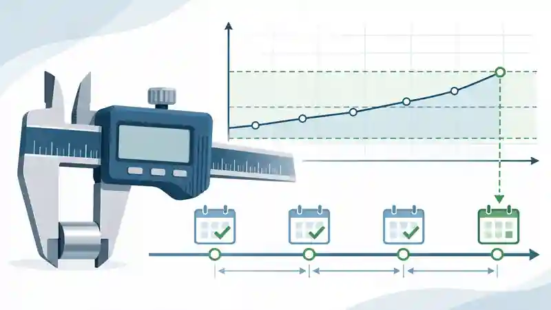
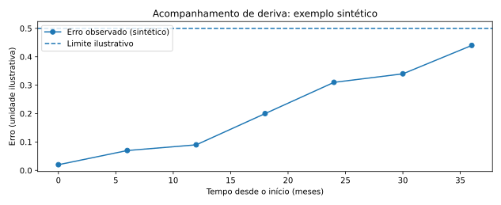

A calibração de equipamentos é essencial para manter a **confiabilidade das medições** realizadas em diferentes processos. No entanto, determinar o intervalo adequado entre calibrações pode ser um desafio, pois envolve fatores técnicos, operacionais e financeiros.

Calibrar com frequência excessiva pode gerar custos desnecessários. Por outro lado, deixar um instrumento muito tempo sem avaliação pode aumentar o risco de utilizar resultados de medição inadequados. Como encontrar um equilíbrio? Vamos conhecer os fatores e os métodos utilizados para definir e revisar essa periodicidade.

## Por que calibrar regularmente?

Calibrar os equipamentos em intervalos planejados tem alguns objetivos importantes:

1. **Manter a confiabilidade das medições:** verificar se o desempenho do equipamento continua adequado às especificações e às necessidades do processo.
2. **Identificar possíveis desvios:** detectar alterações no comportamento do instrumento, como deriva, antes que comprometam resultados e decisões.
3. **Reduzir riscos:** diminuir a possibilidade de aprovar produtos, liberar processos ou tomar outras decisões com base em medições inadequadas.
4. **Sustentar a rastreabilidade metrológica:** manter evidências de calibração e de sua relação com referências apropriadas.

**Um cuidado importante:** realizar calibrações frequentes não garante, por si só, a rastreabilidade metrológica. Ela depende de uma cadeia documentada de calibrações, com contribuições de incerteza apropriadas. O intervalo é apenas uma das decisões de gestão que ajudam a manter a confiança nos resultados ao longo do tempo.

## Fatores que influenciam a periodicidade de calibração

Não existe um único prazo ideal que sirva para todos os equipamentos. Mesmo instrumentos do mesmo modelo podem exigir intervalos diferentes. Os principais fatores a considerar são:

- **Recomendações do fabricante:** costumam ser um ponto de partida útil, embora precisem ser avaliadas conforme o uso real e os requisitos da aplicação.
- **Condições ambientais:** temperatura, umidade, vibração, poeira e outros agentes podem afetar a estabilidade ou acelerar o desgaste.
- **Histórico de calibrações:** resultados anteriores permitem identificar equipamentos estáveis e outros que apresentam deriva ou alterações recorrentes.
- **Frequência e intensidade de uso:** equipamentos submetidos a uso intenso, transporte frequente ou sobrecarga podem demandar acompanhamento mais próximo.
- **Criticidade da medição:** quanto maiores as consequências de um erro, maior deve ser o cuidado ao escolher e revisar o intervalo.
- **Incerteza de medição requerida:** a capacidade metrológica do instrumento deve ser compatível com os requisitos e tolerâncias da aplicação.

Por exemplo, um instrumento utilizado diariamente em ambiente agressivo pode precisar de um intervalo menor do que outro, do mesmo modelo, utilizado esporadicamente em laboratório com ambiente controlado. **A decisão precisa considerar as condições reais de uso**, não apenas o modelo do equipamento.

## Métodos para definir os intervalos de calibração

### 1. Escolha inicial baseada em boas práticas

Quando ainda não existe um histórico de calibrações, é necessário estabelecer um **intervalo inicial**. Ele pode ser definido com base na experiência técnica, nas recomendações do fabricante, em práticas do setor e em requisitos contratuais ou regulamentares aplicáveis.

Essa escolha não deve ser tratada como definitiva: com o tempo, os resultados das calibrações e das verificações intermediárias ajudam a confirmar ou ajustar a periodicidade.

### 2. Monitoramento contínuo

À medida que o equipamento passa por novas calibrações, os registros acumulados permitem avaliar sua estabilidade e **revisar os intervalos com base em evidências**. Duas abordagens úteis são:

**Método de Schumacher.** Nessa abordagem, resultados de calibrações anteriores são classificados em categorias como **Conforme, Não Conforme ou Avariado**. As sequências dessas classificações, analisadas segundo regras previamente estabelecidas, ajudam a decidir se o intervalo deve ser **aumentado, reduzido ou mantido**.

Por exemplo, uma sequência favorável de resultados pode justificar o estudo de uma ampliação do intervalo, enquanto resultados não conformes ou falhas podem exigir redução do prazo e investigação. Isso **não significa** que uma única calibração conforme autorize aumentar automaticamente o intervalo.

**Cartas de controle.** São gráficos utilizados para acompanhar resultados ao longo do tempo, como erros de indicação ou correções. Eles ajudam a identificar tendências, mudanças de comportamento e sinais de instabilidade que poderiam passar despercebidos ao analisar apenas o certificado mais recente.

A figura a seguir apresenta uma **série sintética ilustrativa**, mostrando como o erro de um instrumento pode mudar entre calibrações sucessivas. Ela não é uma carta de controle estatística completa e não representa dados experimentais reais.

{#fig-historico-calibracao fig-cap="Exemplo sintético para ilustrar o acompanhamento de resultados. Não representa medições reais nem uma carta de controle completa."}

**Para aprofundar:** no meu e-book [*Análise Crítica de Certificados de Calibração*](https://rcmayworm.github.io/livro-analise-certificados/), apresento orientações e exemplos de gestão metrológica, análise de resultados e avaliação de intervalos de calibração. A leitura online é gratuita.

### 3. Análise crítica dos resultados

A análise dos certificados é fundamental para avaliar mais do que uma simples indicação de *conforme* ou *não conforme*. É importante observar:

- **Incerteza de medição:** verificar se a incerteza informada é compatível com o uso pretendido e com os critérios de aceitação.
- **Tendência de medição:** comparar os erros ou correções de calibrações sucessivas para identificar possíveis alterações ao longo do tempo.
- **Conformidade com os limites especificados:** examinar os resultados e aplicar a regra de decisão adequada à aplicação.

Instrumentos que apresentam desvios recorrentes podem exigir calibrações mais frequentes ou verificações intermediárias. Equipamentos com desempenho estável podem ser candidatos a intervalos maiores, desde que a mudança seja justificada e documentada.

### 4. Orientações da OIML D 10 e da ISO 10012

A **ILAC-G24:2022 / OIML D 10:2022** é uma referência importante para estabelecer e revisar intervalos de recalibração. Suas orientações destacam a avaliação de risco e consideram fatores como o histórico do instrumento, a possibilidade de ultrapassar limites estabelecidos, as condições ambientais, a intensidade de uso e os custos associados.

Na prática, convém perguntar:

- **Qual seria o impacto de uma medição incorreta?**
- **Qual é o custo de calibrar mais frequentemente e qual é o custo potencial de uma falha?**
- **O histórico do equipamento indica estabilidade ou tendência de alteração?**

A **ISO 10012** aborda sistemas de gestão de medição e contribui para estruturar o controle dos processos e equipamentos, inclusive por meio de registros e avaliação de desempenho.

*Atualização normativa:* quando este artigo foi publicado originalmente, em janeiro de 2025, a edição aplicável era a **ISO 10012:2003**. Ela foi substituída pela **ISO 10012:2026**, publicada em fevereiro de 2026. Já a referência **OIML D 10:2007** citada no texto original foi atualizada para a edição conjunta **ILAC-G24:2022 / OIML D 10:2022**.

### 5. Princípio da relação entre tolerância e incerteza

A chamada **relação de exatidão**, utilizada em algumas práticas de gestão metrológica, compara a tolerância permitida com a incerteza associada à medição. É uma forma de avaliar se a capacidade de medição é adequada à aplicação.

Se ambas forem expressas na mesma unidade, podemos representar essa relação por:

$$
R=\frac{T}{U},
$$

em que $T$ representa a tolerância **definida segundo uma convenção explícita** e $U$ a incerteza de medição considerada. É essencial esclarecer se $T$ corresponde à largura total da faixa de tolerância ou à sua semiamplitude, pois a razão numérica muda conforme essa escolha.

Relações da ordem de **4:1 a 10:1** aparecem como referências práticas em determinados contextos, mas **não constituem uma exigência universal**. A razão deve ser interpretada de acordo com o processo, a regra de decisão e os riscos envolvidos.

**Importante:** essa relação ajuda a verificar a adequação metrológica do instrumento, mas **não determina, isoladamente, o intervalo entre calibrações**. Para escolher a periodicidade, ainda precisamos considerar a estabilidade histórica e as condições de uso.

## Benefícios de uma periodicidade bem definida

1. **Redução de custos:** evita calibrações desnecessariamente frequentes, sem ignorar o risco de falhas.
2. **Maior confiabilidade:** melhora o acompanhamento do desempenho dos instrumentos e das medições utilizadas nos processos.
3. **Apoio à conformidade:** facilita demonstrar que os equipamentos são controlados segundo os requisitos técnicos, contratuais e regulamentares aplicáveis.

## Considerações finais

Determinar os intervalos entre calibrações exige um equilíbrio entre **confiabilidade, risco e custo**. Não basta escolher um número fixo de meses e aplicá-lo a todos os instrumentos: é preciso considerar as condições de uso, o histórico de desempenho e a importância das medições para o processo.

O acompanhamento dos resultados e a revisão documentada dos intervalos ajudam a evitar tanto calibrações desnecessárias quanto a utilização de instrumentos que já não atendam aos requisitos. **Calibrar na hora certa é parte de uma gestão metrológica eficiente**, que agrega valor à qualidade do produto ou serviço.

## Referências

- **ILAC-G24:2022 / OIML D 10:2022.** *Guidelines for the determination of recalibration intervals of measuring equipment*. [Documento oficial](https://www.oiml.org/en/files/pdf_d/d010-e22.pdf).
- **ISO 10012:2026.** *Quality management — Requirements for measurement management systems*. [Ficha oficial da ISO](https://committee.iso.org/standard/10012). A edição anterior era a ISO 10012:2003.
- **ISO/IEC 17025:2017.** *General requirements for the competence of testing and calibration laboratories*. Edição brasileira: ABNT NBR ISO/IEC 17025:2017. [Ficha oficial](https://www.iso.org/standard/66912.html).
- **Albertazzi, A.; Sousa, A. R. de.** *Fundamentos de Metrologia Científica e Industrial*. 2ª ed. Barueri: Manole, 2017. [Registro bibliográfico](https://minhabiblioteca.com.br/catalogo/livro/79470/fundamentos-de-metrologia-cient-fica-e-industrial/).
- **JCGM 200:2012.** *Vocabulário Internacional de Metrologia (VIM)*. [Publicações JCGM](https://www.bipm.org/en/committees/jc/jcgm/publications).
- **JCGM 100:2008.** *Evaluation of measurement data — Guide to the expression of uncertainty in measurement (GUM)*. [Publicações JCGM](https://www.bipm.org/en/committees/jc/jcgm/publications).

## Leia mais

- [A fascinante jornada da Metrologia: da antiguidade aos dias atuais](../a-fascinante-jornada-da-metrologia/index.qmd)
- [Análise Crítica de Certificados de Calibração: um guia prático](../analise-critica-certificados-calibracao/index.qmd)
- [Exatidão x Precisão: Qual a Diferença e Por Que Importa na Medição?](../exatidao-e-precisao/index.qmd)
- [Estimativa de Incerteza em Regressões Lineares: Um Guia Prático com Python](../incerteza-regressao-linear-python/index.qmd)
