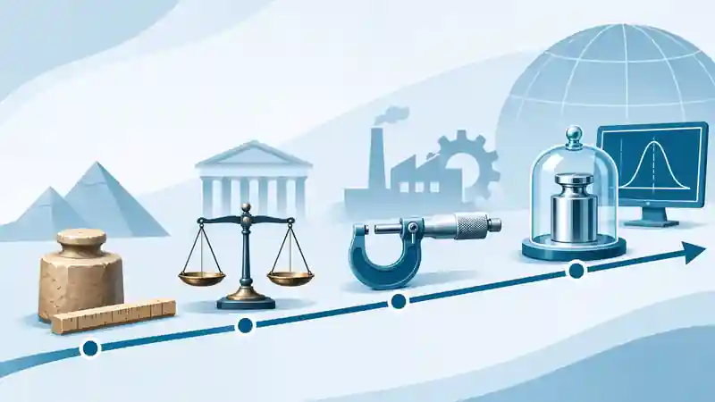

> **About this edition:** an original article first published on [LinkedIn (13 February 2025)](https://www.linkedin.com/pulse/fascinante-jornada-da-metrologia-antiguidade-aos-dias-ruan-mayworm-9l8of/) and republished by [ASMETRO-SI (14 February 2025)](https://asmetro.org.br/portalsn/2025/02/14/a-fascinante-jornada-da-metrologia-da-antiguidade-aos-dias-atuais/). This online edition updates historical and metrological details while retaining the blog's standard cover. Historic images from the original publication have been reintroduced with revised captions.

Since the beginnings of civilisation, measurement has been an essential tool for human development. Metrology, the science of measurement, has followed a long and fascinating path marked by discoveries, challenges and remarkable episodes. Its development reflects humanity's continuing search for precision, order and progress.

## Early measurements and standards in antiquity

::: {.metrology-history-figure}
{fig-cap="Egyptian-themed historical illustration used in the original publication to introduce the history of measurement. Source attributed to [Measurement Science Conference — History of Metrology](https://msc-conf.com/history-of-metrology/), reproduced by [ASMETRO-SI](https://asmetro.org.br/portalsn/2025/02/14/a-fascinante-jornada-da-metrologia-da-antiguidade-aos-dias-atuais/)."}
:::

In antiquity, many units of length were based on parts of the human body. The cubit, for example, was associated with the length of the forearm, but its value varied across regions and periods. The **Egyptian royal cubit**, used in monumental construction, was approximately **52.3 cm** and was subdivided into seven palms of four fingers each. Other traditions used shorter cubits, of around 45 cm. Similarly, the foot and inch have been used historically in various systems of measurement. [Source: historical study of the cubit](https://doi.org/10.1155/2014/489757).

Units defined solely by individual body measurements could vary from person to person. Material standards helped make measurements more consistent. The pyramids of Giza are remarkable examples of ancient surveying, alignment and construction techniques; numerical estimates of their accuracy depend on the survey concerned and the structures' state of preservation.

The existence of cubit rods and standards in Egypt shows concern for uniformity in measurement. Popular stories about death sentences for failure to comply with calibration requirements are not presented here as historical facts, because sufficient primary documentation was not found.

::: {.metrology-history-figure}
{fig-cap="The royal master cubit, measuring 52.9 cm, was the primary standard carved from granite. Workers received copies made of wood or granite, and accuracy was checked at every full moon, under penalty of death."}
:::

An early cultural reference appears in the Bible, in Genesis 6:15, which describes Noah's Ark as 300 cubits long, 50 cubits wide and 30 cubits high. **Hypothetically assuming** a cubit of 45 cm gives dimensions of 135 m, 22.5 m and 13.5 m, respectively. These numbers illustrate the conversion of historical units and **are not archaeological measurements**. Other cubit conventions produce different results.

This passage illustrates how ancient units also remain part of cultural and religious texts.

## The creation of the metre and the standardisation of units

As trade and engineering projects expanded, universal standards became increasingly necessary. At the end of the eighteenth century, the French introduced the metre as a unit of length defined as one ten-millionth of a quarter of the Earth's meridian. This definition followed measurements undertaken by astronomers Delambre and Méchain between Dunkirk, France, and Montjuïc, Spain.

The story of this expedition, with its political, geographical and personal challenges, is told in Ken Alder's book *The Measure of All Things*, which examines the difficulties faced by the scientists and the project's impact on modern science. Despite its revolutionary importance, the original definition was not perfect, owing to inaccuracies in the geographical measurements. A platinum bar was made to provide a material realisation of the metre.

Since 1983, the definition of the metre has been associated with the speed of light in vacuum. In the present SI, it follows from fixing the numerical value \(c=299\,792\,458\ \mathrm{m\,s^{-1}}\), together with the definition of the second. [Official history of the metre — BIPM](https://www.bipm.org/en/history-si/metre).

In Brazil, adoption of the metric system was strongly associated with Emperor Dom Pedro II, who had a keen interest in science. On **26 June 1862**, Imperial Law No. 1,157 provided for adoption of the metric system in Brazil, including a transition period. The change nevertheless encountered public resistance, especially among merchants and craftspeople accustomed to older units such as palms and inches.

Resistance to the new measures formed part of the **Quebra-Quilos Revolt**, which took place chiefly in **1874 and 1875** in provinces of northeastern Brazil. The protests included the destruction of weights and measuring instruments and also expressed dissatisfaction with taxation, military recruitment and the actions of public authorities. The transition to uniform standards was not free of conflict. [Source: Brazil's National Archives](https://historialuso.an.gov.br/index.php?Itemid=121&catid=2087&id=5734%3Asistema-metrico-decimal&option=com_content&view=article).

::: {.metrology-history-figure}
{fig-cap="Poster of the Quebra-Quilos Revolt."}
:::

## Metrology during the Industrial Revolution and the twentieth century

The Industrial Revolution brought major advances in metrology. Precision became essential to mass production, encouraging the development of instruments such as gauges, callipers and analytical balances. Such advances enabled tighter control of industrial-component manufacturing and the formulation of chemical and pharmaceutical products.

A decisive moment in international cooperation came with the signing of the **Metre Convention on 20 May 1875**. This treaty established the International Bureau of Weights and Measures (BIPM) and a permanent structure for the worldwide uniformity of measurements. [Source: BIPM](https://www.bipm.org/en/metre-convention/).

In contemporary metrology, **metrological traceability** is a property of a *measurement result* whereby it can be related to a reference through a documented, unbroken chain of calibrations, each contributing to the measurement uncertainty. It should not be confused with an intrinsic property of an instrument. [VIM, entry 2.41](https://jcgm.bipm.org/vim/en/2.41.html).

During the twentieth century, developments in electronics and optics made previously unimaginable measurement precision possible. Optical measurement techniques and electronic instruments drove progress in fields such as nanotechnology and microelectronics. Measurement standards also came to be defined in terms of physical constants. The second, for example, is based on a transition frequency of the caesium atom, while the kilogram was redefined in terms of the Planck constant.

Modern atomic clocks offer extraordinary stability and accuracy, essential for satellite navigation, telecommunications and system synchronisation. However, statements about how much error a clock would accumulate over millions of years **depend on the clock model and operating conditions**; no such performance applies universally to all atomic clocks.

::: {.metrology-history-figure}
{fig-cap="The atomic clock of Germany's National Metrology Institute (Physical Technical Federal Institution - PTB). Source: https:// www.ptb.de"}
:::

## Metrology in everyday life and in the future

Today, metrology is deeply embedded in everyday activities, often without being noticed. At filling stations, metrological control of fuel dispensers helps ensure that indicated quantities comply with the applicable requirements and maximum permissible errors. In hospitals, reliable measurements are essential for laboratory tests and medical equipment. In e-commerce, accurate measurements of product mass and dimensions help determine shipping charges.

Another everyday example is blood-pressure measurement, essential for monitoring the health of millions of people worldwide. In agriculture, measuring instruments help ensure efficient application of inputs, improving productivity and reducing environmental impacts.

Metrology will continue to play a central role in technological development, particularly as automation and digitalisation expand. Artificial intelligence and the Internet of Things depend on increasingly capable sensors integrated into reliable measurement systems. Quantum metrology, which uses phenomena at the atomic and subatomic scales to achieve new levels of performance, also offers potential advances in telecommunications, computing and space exploration.

The history of metrology reflects human progress, from rudimentary measurements based on the human body to sophisticated modern standards defined through universal constants. This development has transformed science and technology and shaped the way we interact with the world. Have you considered the role metrology plays in your own life?

*An editorial adaptation of previously published original work. The blog's standard cover is original to this website; historic images were selected for the earlier publication. Sources are credited where identified, without presuming third-party reuse licences.*

## References and Sources

- **BIPM.** *The International System of Units (SI)*, 9th edition (2019, updated in 2026). [DOI: 10.59161/AUEZ1291](https://doi.org/10.59161/AUEZ1291).

- **JCGM 200:2012.** *International Vocabulary of Metrology — Basic and general concepts and associated terms (VIM)*, 3rd edition. [DOI: 10.59161/JCGM200-2012](https://doi.org/10.59161/JCGM200-2012).

- **BIPM.** *The Metre Convention* (1875). [Official source](https://www.bipm.org/en/metre-convention/).

- **BIPM.** *Historical perspective: metre*. [Official source](https://www.bipm.org/en/history-si/metre).

- **National Archives of Brazil.** *Sistema Métrico Decimal*: introduction in Brazil and the Quebra-Quilos Revolt. [Historical source (Portuguese)](https://historialuso.an.gov.br/index.php?Itemid=121&catid=2087&id=5734%3Asistema-metrico-decimal&option=com_content&view=article).

- **Stone, M. H. (2014).** *The Cubit: A History and Measurement Commentary*. *Journal of Anthropology*, 2014, article 489757. [DOI: 10.1155/2014/489757](https://doi.org/10.1155/2014/489757).

- **Alder, K. (2003).** *A medida de todas as coisas: a odisséia de sete anos e o erro encoberto que transformaram o mundo*. Rio de Janeiro: Objetiva. ISBN 85-7302-511-5 (in Portuguese). [Bibliographic record (BnF)](https://catalogue.bnf.fr/ark:/12148/cb39973400f).

- **The Holy Bible.** Genesis 6:15 (cultural reference, not experimental metrological evidence).

## Further Reading

- **The Fascinating Journey of Metrology: From Antiquity to the Present Day** *(this article)*
- [Critical Review of Calibration Certificates: A Practical Guide](../analise-critica-certificados-calibracao/index.qmd)
- [Accuracy vs Precision: What Is the Difference and Why Does It Matter in Measurement?](../exatidao-e-precisao/index.qmd)
- [Uncertainty Estimation in Linear Regression: A Practical Guide with Python](../incerteza-regressao-linear-python/index.qmd)
- [How to Determine Calibration Intervals for Measuring Equipment](../intervalos-entre-calibracoes/index.qmd)
