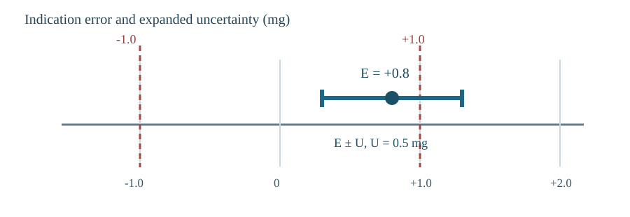
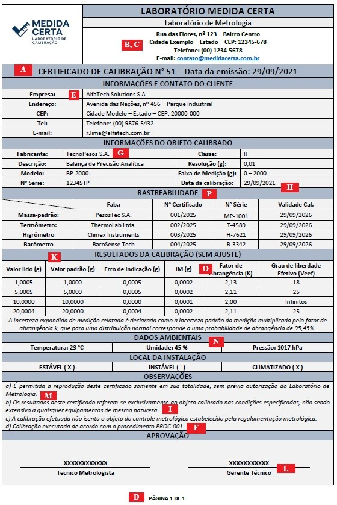

{fig-alt="Illustration of a calibration certificate being checked with a magnifying glass, measurement symbols, verification marks and warnings."}

In engineering and quality management, reliable measurements are essential. A product may be accepted or rejected, a process authorised or stopped, and even financial decisions may depend on a single measurement result.

For this reason, **calibration certificates should not be regarded merely as administrative paperwork** required to comply with standards. They provide information needed to assess whether an instrument remains suitable for its intended use.

How should we review them? What information should we check? How should the results be interpreted? Let us address these questions with a practical example.

## What is a calibration certificate?

According to the **International Vocabulary of Metrology (VIM)**, calibration establishes, under specified conditions, a relationship between reference values (and their uncertainties) and the corresponding indications of a measuring instrument (also with their uncertainties). This relationship may be expressed in different forms, such as a statement, table or calibration curve.

In practice, a **calibration certificate** records the information needed to understand the work performed: which instrument was calibrated, what standards were used, under what conditions the calibration took place and what results were obtained.

The certificate is therefore more than a document to archive. It is **technical evidence** supporting metrological traceability and measurement reliability within a quality management system.

However, an important distinction remains: **holding a calibration certificate does not automatically mean that an instrument is acceptable for every application**. Such a conclusion requires assessing its results against the requirements of the process.

## What does ISO/IEC 17025:2017 require?

**ABNT NBR ISO/IEC 17025:2017** sets out requirements for the competence of testing and calibration laboratories. Clause **7.8 — Reporting of results** addresses information to be included in reports and certificates, including requirements specific to calibration.

The standard does not require every certificate to look the same. What matters is that results are reported clearly and objectively, together with the information necessary to interpret them.

### What should be checked in a certificate?

When receiving a certificate, the following checklist can guide the review:

| Information | What to check |
|:---|:---|
| **Document identification** | Title, number or unique certificate identification, and confirmation that the document is complete |
| **Responsible laboratory** | Name, address and location where the calibration was performed |
| **Customer** | Identification of the party requesting the calibration |
| **Calibrated instrument** | Description, manufacturer, model, serial number and other details enabling identification |
| **Method used** | The procedure or method used for calibration |
| **Dates** | Date of calibration and date of certificate issue |
| **Results and units** | Indications, reference values, errors or corrections, as appropriate to the method, and corresponding units |
| **Measurement uncertainty** | Uncertainty associated with the results and information necessary for its interpretation |
| **Metrological traceability** | Information relating the results to metrological references |
| **Relevant environmental conditions** | Temperature, humidity and other conditions affecting the results |
| **Adjustments or repairs** | Where applicable, results before and after these interventions, if available |
| **Authorisation to issue** | Identification of the person authorised to issue the report |
| **Notes and statements** | Limitations on use, reproduction provisions and statements of conformity, where applicable |

: Teaching checklist for reviewing the information in a calibration certificate. {#tbl-verificacao}

This table summarises important elements but **does not replace the full requirements of the standard**. Some information depends on the type of calibration, the activities performed and what was agreed with the customer.

Two further points require attention:

- When the laboratory issues a **statement of conformity**, the applicable decision rule must be considered in accordance with the relevant requirements.
- The certificate **should not automatically recommend the date of the next calibration** unless this has been agreed with the customer. Determining the calibration interval also depends on the instrument's use and the process requirements.

## How should a certificate be interpreted in practice?

Checking that all fields are filled in is only the first step. We must then understand the **calibration results** and determine whether they are suitable for the intended application.

A common mistake is to examine only the indication error while ignoring **measurement uncertainty**. Both are relevant to a conformity decision under the adopted **decision rule**.

### Example: an analytical balance

Suppose that, for a specific application, a balance has a **maximum permissible error (MPE)** of **±1.0 mg**. Its calibration result is:

| Information | Value |
|:---|---:|
| Maximum permissible error (MPE) | ±1.0 mg |
| Indication error ($E$) | +0.8 mg |
| Expanded uncertainty ($U$) | 0.5 mg |
| Coverage factor ($k$) | 2 |

: Illustrative numerical example. {#tbl-exemplo-balanca}

The observed error, **+0.8 mg**, is within ±1.0 mg. However, this is not sufficient to state that the balance can be accepted under every possible decision rule.

One way of visualising the situation is to consider the interval **$E\pm U$**, which in this example ranges from **+0.3 mg to +1.3 mg**. This extends beyond the upper limit of +1.0 mg.

{#fig-exemplo-balanca fig-cap="Illustrative example: an error of +0.8 mg, expanded uncertainty of 0.5 mg and limits of ±1.0 mg."}

**Important:** the interval $E\pm U$ is not an absolute bound within which the true error must necessarily lie. The statistical interpretation of uncertainty depends on the assumptions and evaluation procedure used.

For example, if we adopt a **conservative acceptance rule**, we may require:

$$
|E|+U\leq MPE.
$$

Substituting the numerical values:

$$
0.8+0.5=1.3\ \mathrm{mg}>1.0\ \mathrm{mg}.
$$

In this situation, **conformity cannot be declared under the chosen conservative rule**, even though the nominal error lies within the MPE.

This does not mean every decision rule would lead to the same outcome: the acceptance criterion depends on applicable requirements and the risk of incorrectly accepting or rejecting an instrument. In some cases, the decision may be inconclusive.

The **MPE** is the error limit permitted for a particular application. It may arise from regulatory requirements, specifications or the needs of a measurement process. There is therefore no single MPE appropriate to all instruments and uses.

## Illustrative example: reviewing a certificate

@fig-certificado shows a **fictitious analytical balance calibration certificate** issued by the fictitious *Medida Certa* laboratory. It was created solely for educational purposes.

{#fig-certificado width="560px" fig-align="center" fig-cap="Fictitious calibration certificate with annotations highlighting information to check during a critical review."}

[Open the certificate image at its original size](../../../../blog/posts/analise-critica-certificados-calibracao/images/certificado-ficticio-original.jpg).

The **red letters in @fig-certificado** form a reading guide. Find each letter in the image and use @tbl-marcacoes-certificado to identify the corresponding information and why it matters.

| Mark | Where to look | What to verify |
|:---:|:---|:---|
| **A** | Certificate title and number | Identify the document and its number, **Certificate No. 51** in this example. |
| **B** | Laboratory name | Confirm who performed the calibration: fictitious **Laboratório Medida Certa**. |
| **C** | Laboratory address and contact details | Check the issuing laboratory's identification and contact details. |
| **D** | Footer — **page 1 of 1** | Check page identification and that all pages are present. |
| **E** | Customer information | Identify the certificate recipient, fictitious **AlfaTech Solutions S.A.** in this example. |
| **F** | Notes — procedure **PROC-001** | Identify the calibration procedure used. |
| **G** | Details of the calibrated item | Check the description, manufacturer, model and serial number of the balance against the actual instrument. |
| **H** | Calibration date — **29/09/2021** | Distinguish the date calibration was performed from the date of issue. |
| **I** | Note about applicability of results | Confirm that results apply only to the item calibrated. |
| **K** | Calibration results | Examine indicated values, reference values and indication errors, with their units. |
| **L** | Approval field | Check the identification and authorisation of the person responsible for issue. |
| **M** | Reproduction note | Check the provision for complete reproduction of the certificate, preserving context. |
| **N** | Environmental data | Identify recorded conditions, such as **23 °C** and **45% relative humidity**. |
| **O** | Coverage factor **($k$)** | Check the factor used to express expanded uncertainty; uncertainty is shown in the **IM (g)** column of the results table. |
| **P** | Traceability | Identify the standards and reference instruments used and their certificate details. |

: Correspondence between the red markings in @fig-certificado and the fields of the fictitious certificate. {#tbl-marcacoes-certificado tbl-colwidths="[12,33,55]"}

For example, to review one result, start with marking **K** and check the indication error and unit. Next, examine uncertainty in the **IM (g)** column and the coverage factor identified by marking **O**. Compare this information with the MPE applicable to your process and apply the appropriate decision rule. **The certificate alone does not establish whether the balance conforms.**

These markings are provided **for teaching purposes**; they are not official numbering of ISO/IEC 17025 requirements. The identification of reference standards in field **P**, for example, supports the document review but does not replace evaluation of the necessary traceability information.

The certificate contains fictitious data and **does not use the same values as the numerical balance example in the preceding section**.

### Does a certificate guarantee that the instrument is suitable?

**Not necessarily.** A certificate reports results obtained during calibration under specified conditions. The user must establish whether these results meet the requirements of the intended process.

Information on indication error, uncertainty, traceability and other aspects helps determine whether the instrument can remain in service or needs adjustment, repair or replacement.

In other words, **a calibrated instrument is not automatically suitable for a particular process**.

## Conclusion

Critically reviewing calibration certificates is an important competence for professionals in engineering, metrology and quality management.

Rather than merely confirming that a document exists, we must **interpret its results** and compare them with the application requirements. Properly understood, a certificate becomes more than an administrative attachment: it supports technical decisions, audits, traceability and continuing improvement of measurement processes.

## References and Sources

- **ISO/IEC 17025:2017.** *General requirements for the competence of testing and calibration laboratories*. Brazilian adoption: ABNT NBR ISO/IEC 17025:2017.

- **JCGM 200:2012.** *International Vocabulary of Metrology — Basic and general concepts and associated terms (VIM)*, 3rd edition. [DOI: 10.59161/JCGM200-2012](https://doi.org/10.59161/JCGM200-2012). [VIM definition of calibration](https://jcgm.bipm.org/vim/en/2.39.html).

- **Williams, A.; Magnusson, B. (eds.).** *Eurachem/CITAC Guide: Use of uncertainty information in compliance assessment*. 2nd edition, 2021. ISBN 978-0-948926-38-9. [Official publication](https://www.eurachem.org/index.php/publications/guides/uncertcompliance).

- **JCGM 100:2008(E).** *Evaluation of measurement data — Guide to the expression of uncertainty in measurement (GUM).* [DOI: 10.59161/JCGM100-2008E](https://doi.org/10.59161/JCGM100-2008E).

- **Mendes, A.; Rosário, P. P.** *Metrologia e Incerteza de Medição — Conceitos e Aplicações*. 1st edition. LTC, 2020. ISBN 9788521636755 (in Portuguese).

## Further Reading

- [The Fascinating Journey of Metrology: From Antiquity to the Present Day](../a-fascinante-jornada-da-metrologia/index.qmd)
- **Critical Review of Calibration Certificates: A Practical Guide** *(this article)*
- [Accuracy vs Precision: What Is the Difference and Why Does It Matter in Measurement?](../exatidao-e-precisao/index.qmd)
- [Uncertainty Estimation in Linear Regression: A Practical Guide with Python](../incerteza-regressao-linear-python/index.qmd)
- [How to Determine Calibration Intervals for Measuring Equipment](../intervalos-entre-calibracoes/index.qmd)
