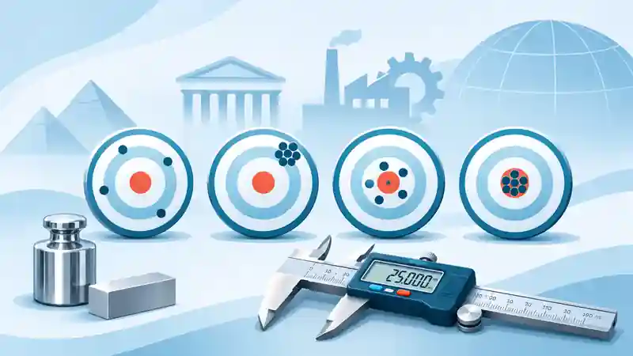
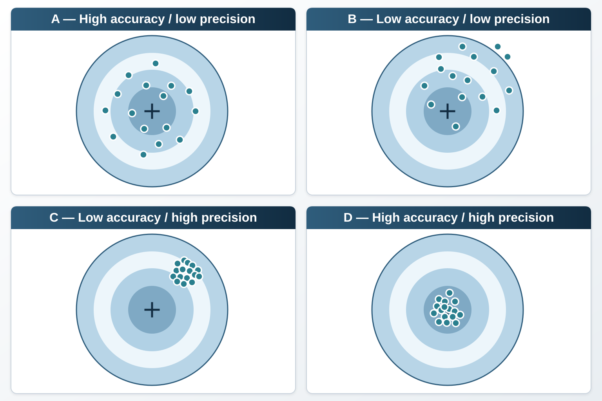

Whenever we measure a quantity—whether temperature, pressure or the dimensions of a mechanical component—two fundamental concepts arise: **accuracy** and **precision**. Although frequently confused, they have different meanings and directly affect the reliability of measurement results.

To explain the distinction, we will first consider simple examples and then show how these concepts can be examined mathematically.

## What is measurement accuracy?

**Accuracy describes the closeness of a measured value to a true value of the quantity being measured.** Smaller measurement error generally corresponds to greater measurement accuracy.

According to the **International Vocabulary of Metrology (VIM)**, measurement accuracy concerns the closeness of agreement between a measured quantity value and a true quantity value of a measurand.

The VIM makes an important distinction: **accuracy is not itself a quantity and therefore cannot be assigned a numerical value directly**. Measurement error can, however, help evaluate closeness to a reference.

### Accuracy example

Consider a correctly calibrated thermometer indicating **37.2 °C** when measuring a person's body temperature. If the reference temperature were exactly **37.2 °C**, the measurement error relative to that reference would be zero.

Another example is a balance used in a pharmaceutical laboratory. If a substance has a reference mass of **100.00 g**, but the balance indicates **99.98 g**, the difference is **−0.02 g**. The absolute error is **0.02 g**.

Depending on process tolerances and measurement uncertainty, this error may be sufficiently small for the intended application.

Measurement accuracy may be affected by calibration, instrument drift over time and sensor characteristics. If measurement errors are not properly evaluated, decisions based on the results may be compromised.

## What is measurement precision?

**Precision is the closeness of agreement among repeated measurement results obtained under specified conditions.**

In simpler terms, when we repeatedly measure the same quantity, precision helps us assess **how close the results are to one another**. Less dispersion indicates greater observed precision under the conditions considered.

According to the VIM, precision concerns agreement among indications or measured quantity values obtained through replicate measurements under specified conditions. Depending on these conditions, we can examine repeatability or reproducibility.

### Precision example

Suppose we measure the diameter of a metal component three times using a calliper and obtain:

- **15.23 mm**
- **15.24 mm**
- **15.22 mm**

These results are close to one another, suggesting **good precision** under the conditions of this small set of measurements.

However, we do not yet know whether the diameter value is correct. To assess **accuracy**, we would need to compare it with an appropriate reference value.

Precision can be affected by electronic noise, environmental variations, operator instability or changes in measurement procedures. Recording and controlling the measurement conditions is therefore important.

## How can accuracy and precision be evaluated quantitatively?

Although accuracy cannot be expressed directly as a number, we can **evaluate measurement error** by comparing a result with a reference value.

### Measurement error

This article uses the following expression:

$$
E=X-VVC
$$

where:

- $E$ = measurement error;
- $X$ = measured value;
- $VVC$ = conventional true value, a historical term for a conventional value used as a reference.

*Terminology note:* under the current VIM, **reference quantity value** or **conventional quantity value** is generally preferable, depending on the context. The calculation remains the same: **error = measured value − reference value**.

Returning to the balance example:

$$
E=99.98-100.00=-0.02\ \mathrm{g}.
$$

The negative sign indicates that the balance reading was **below** the reference. The absolute error, $|E|=0.02\ \mathrm{g}$, expresses the magnitude of the difference.

### Dispersion of measurement results

Precision can be examined through the dispersion of results. **Standard deviation** and **variance** are among the most widely used statistical measures for this purpose.

A descriptive expression for the standard deviation of a complete set of $n$ values is:

$$
\sigma=\sqrt{\frac{\sum_{i=1}^{n}(X_i-X_m)^2}{n}}
$$

where:

- $\sigma$ = standard deviation of the values considered;
- $X_i$ = each individual measured value;
- $X_m$ = mean of the measured values;
- $n$ = number of measurements.

**The smaller the standard deviation, the smaller the dispersion of the results.** This tells us how closely repeated measurements cluster together.

**An important detail:** when the results constitute a *sample* and we wish to estimate the standard deviation of the measurement process, the **sample standard deviation**, using $n-1$ in the denominator, is commonly employed:

$$
s=\sqrt{\frac{\sum_{i=1}^{n}(X_i-\bar X)^2}{n-1}}.
$$

For the calliper example, the mean of the three readings is **15.23 mm**, and the sample standard deviation is **0.01 mm**. This calculation describes the observed dispersion; on its own, it does not establish proximity to the true value.

## Accuracy and precision in practice

An analogy involving a **shooting target** can help visualise the distinction.

Imagine that the centre of the target represents the value we want to measure. Each mark represents one result. The location of the marks relative to the centre, and how closely they cluster, illustrate four situations.

{#fig-alvos fig-cap="Figure 1 — Four illustrative combinations of accuracy and precision. The cross represents a reference and the dots repeated measurements. This analogy is not a substitute for a metrological evaluation."}

The situations in @fig-alvos represent:

- **A — High accuracy and low precision:** the results are dispersed but, considered together, are close to the centre of the target.
- **B — Low accuracy and low precision:** the results are scattered, generally far from the centre, without a well-defined cluster.
- **C — High precision and low accuracy:** the results form a tight group, but far from the centre.
- **D — High accuracy and high precision:** the results cluster near the centre.

Very similar results can therefore be obtained while remaining far from the correct value. Conversely, dispersed results can have a mean close to the reference value.

This analogy helps explain why **accuracy and precision are not synonyms** and why both concepts are relevant to metrology, quality control and scientific experiments.

## Why does the distinction matter?

In industrial processes and laboratories, accuracy and precision directly influence product quality and confidence in measurement results. Instruments must be suitable for their intended use and **calibrated at intervals chosen according to the application and associated risks**.

Several examples illustrate their relevance:

- **Pharmaceutical industry:** reliable measurements help control drug dosage.
- **Engineering:** suitable measurement results help ensure structures and components meet their specifications.
- **Commerce:** reliable scales promote fair transactions and reduce errors in the quantities traded.
- **Meteorology:** measurements of temperature, pressure and other quantities are essential for monitoring and forecasting atmospheric conditions.

In each of these cases, assessing repeatability alone is insufficient. We also need to know whether results are close to suitable reference values and **what measurement uncertainty is associated with them**.

## Conclusion

Both accuracy and precision matter. Understanding the distinction helps prevent incorrect interpretations of measurement results.

An instrument may provide results that are **precise but not particularly accurate**, or **imprecise results whose mean is close to a reference value**. The desired situation combines good precision with accuracy appropriate to the measurement purpose.

Finally, evaluating **measurement uncertainty** complements this assessment and helps establish whether results are sufficiently reliable for the decision at hand.

## References and Sources

- **JCGM 200:2012.** *International Vocabulary of Metrology — Basic and general concepts and associated terms (VIM)*, 3rd edition. [DOI: 10.59161/JCGM200-2012](https://doi.org/10.59161/JCGM200-2012). Definitions: [accuracy](https://jcgm.bipm.org/vim/en/2.13.html), [precision](https://jcgm.bipm.org/vim/en/2.15.html) and [measurement error](https://jcgm.bipm.org/vim/en/2.16.html).

- **BIPM.** *The International System of Units (SI)*, 9th edition (2019, updated in 2026). [DOI: 10.59161/AUEZ1291](https://doi.org/10.59161/AUEZ1291).

- **JCGM 100:2008(E).** *Evaluation of measurement data — Guide to the expression of uncertainty in measurement (GUM).* [DOI: 10.59161/JCGM100-2008E](https://doi.org/10.59161/JCGM100-2008E).

- **Mendes, A.; Rosário, P. P.** *Metrologia e Incerteza de Medição — Conceitos e Aplicações*. 1st edition. LTC, 2020. ISBN 9788521636755 (in Portuguese).

## Further Reading

- [The Fascinating Journey of Metrology: From Antiquity to the Present Day](../a-fascinante-jornada-da-metrologia/index.qmd)
- [Critical Review of Calibration Certificates: A Practical Guide](../analise-critica-certificados-calibracao/index.qmd)
- **Accuracy vs Precision: What Is the Difference and Why Does It Matter in Measurement?** *(this article)*
- [Uncertainty Estimation in Linear Regression: A Practical Guide with Python](../incerteza-regressao-linear-python/index.qmd)
- [How to Determine Calibration Intervals for Measuring Equipment](../intervalos-entre-calibracoes/index.qmd)
