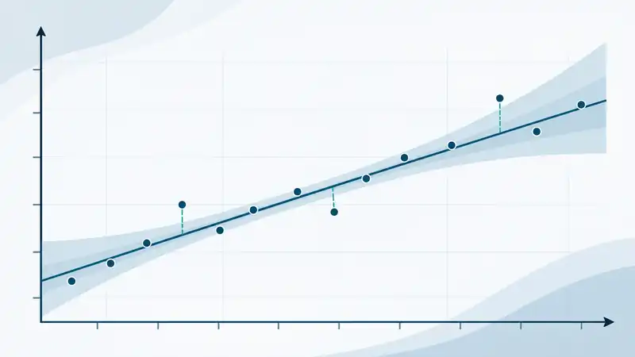
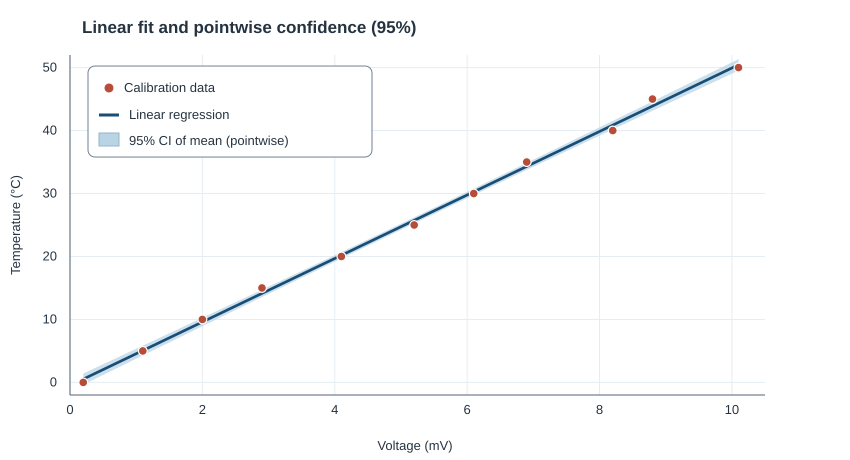
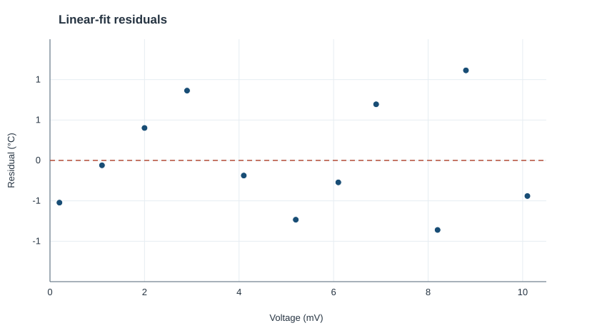
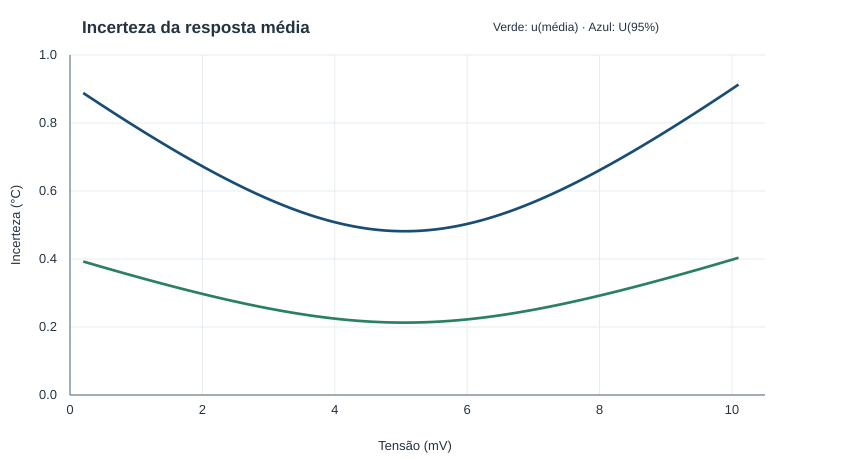

Regression analysis is fundamental to modelling relationships between variables and is widely used in engineering, science and finance. Beyond fitting a model, however, it is essential to quantify the uncertainty of its predictions so that estimates can be interpreted more reliably.

This article explains how to estimate uncertainty in linear regression, reviews the underlying theory and presents a practical example using **Python**.

## Least-squares method

The **least-squares method** determines the line that best fits a set of data. It is also widely used to determine **calibration curves**, applying methods from linear algebra.

In regression analysis, we start with $n$ pairs of observations, $(x_i,y_i)$. For a polynomial of degree $m$, we can write:

$$
y_i=\beta_0+\sum_{j=1}^{m}\beta_j x_i^j+\varepsilon_i.
$$

Here, the coefficients $\beta_j$ are the parameters to be estimated, while $\varepsilon_i$ represents the difference between the observed value and the modelled value.

The equations can also be expressed in matrix form:

$$
\begin{bmatrix}
y_1\\y_2\\\vdots\\y_n
\end{bmatrix}
=
\begin{bmatrix}
1&x_1&x_1^2&\cdots&x_1^m\\
1&x_2&x_2^2&\cdots&x_2^m\\
\vdots&\vdots&\vdots&&\vdots\\
1&x_n&x_n^2&\cdots&x_n^m
\end{bmatrix}
\begin{bmatrix}
\beta_0\\\beta_1\\\vdots\\\beta_m
\end{bmatrix}
+
\begin{bmatrix}
\varepsilon_1\\\varepsilon_2\\\vdots\\\varepsilon_n
\end{bmatrix}.
$$

Solving the least-squares problem yields estimates of the coefficients $\beta_j$. With a first-degree polynomial—a **linear regression with a straight line**—the model simplifies to:

$$
y=\beta_0+\beta_1x+\varepsilon.
$$

In this case, $\beta_0$ is the **intercept** (where the line crosses the vertical axis) and $\beta_1$ is the **slope** (the change in $y$ per unit change in $x$).

### Covariance matrix of fitted coefficients

After finding the fitted line, an important question remains: **what is the uncertainty associated with the estimated coefficients?**

Uncertainties in the estimated parameters can be obtained from the **covariance matrix $C$** of the coefficients $\beta_j$. Its diagonal elements contain their individual variances, whose square roots are the **standard uncertainties** of $\beta_0$ and $\beta_1$.

For ordinary least squares, the estimated covariance matrix is:

$$
C=s^2(X^\mathsf{T}X)^{-1}.
$$

Here, $X$ is the regression design matrix and $s^2$ is the **residual variance**, calculated as:

$$
s^2=\frac{\sum_{i=1}^{n}(y_i-\hat y_i)^2}{n-p}.
$$

where:

- $y_i$ denotes the observed values;
- $\hat y_i$ denotes the values calculated using the regression;
- $n$ is the number of observations;
- $p$ is the number of fitted parameters (for a straight line, $p=2$: intercept and slope).

The covariance matrix helps characterise uncertainty in the fitted coefficients. It is **symmetric**: the covariance of two coefficients is the same whichever order is used.

The main diagonal contains the coefficient variances; the off-diagonal elements describe how the coefficients vary together. This matters because **covariance between intercept and slope must not be ignored** when propagating uncertainty through the fitted line.

For linear regression, the matrix takes the form:

$$
C=
\begin{bmatrix}
s_{00}&s_{01}\\
s_{01}&s_{11}
\end{bmatrix},
$$

where $s_{00}$ is the intercept variance, $s_{11}$ the slope variance and $s_{01}$ their covariance.

*Note:* high covariance alone is not evidence of a multicollinearity problem. Correlation between intercept and slope can occur naturally, depending on the values of $x$.

## How to estimate uncertainty in linear regression

The **Guide to the Expression of Uncertainty in Measurement (JCGM 100)** provides general rules for evaluating and expressing measurement uncertainty. Given a mathematical model relating input and output quantities, the law of propagation of uncertainty may be applied:

$$
u_c^2(y)=
\sum_{i=1}^{q}
\left(\frac{\partial f}{\partial x_i}\right)^2u^2(x_i)
+
2\sum_{i=1}^{q-1}\sum_{j=i+1}^{q}
\frac{\partial f}{\partial x_i}
\frac{\partial f}{\partial x_j}
u(x_i,x_j).
$$

The terms $u(x_i)$ are the standard uncertainties associated with the input quantities, and $u(x_i,x_j)$ is their covariance.

To apply this equation to linear regression, consider:

$$
\hat y=\hat\beta_0+\hat\beta_1x.
$$

Assuming a known value of $x$, the partial derivatives with respect to the two fitted coefficients are:

$$
\frac{\partial\hat y}{\partial\hat\beta_0}=1,
\qquad
\frac{\partial\hat y}{\partial\hat\beta_1}=x.
$$

Substitution into the propagation equation gives:

$$
\boxed{
u_A^2(x)=s_{00}+x^2s_{11}+2xs_{01}
}.
$$

This is one of the central equations in the example. It gives the **standard uncertainty of the estimated mean response** from the fitted line, including coefficient variances and their covariance.

Other relevant contributions, such as uncertainties associated with reference standards, must also be evaluated. For **independent contributions** already expressed in units of the output quantity, a simplified combination is:

$$
u_c=\sqrt{u_A^2+u_B^2}.
$$

An important distinction is that **estimating the mean response from the regression line is not the same as predicting an individual new measurement**. For an individual prediction, residual dispersion must also be considered:

$$
u_{\mathrm{pred}}(x)=\sqrt{u_A^2(x)+s^2}.
$$

This example focuses on uncertainty in the **regression mean response**, calculated from the coefficients $\beta_0$ and $\beta_1$.

Finally, **expanded uncertainty** is obtained by multiplying standard uncertainty by a coverage factor $k$:

$$
U(x)=k\,u_c(x).
$$

For the pointwise 95% confidence intervals used here, $k$ is obtained from **Student's t-distribution**, with $n-p$ degrees of freedom. This assumes the usual statistical conditions for linear regression.

## Practical example: thermocouple calibration

Let us apply these concepts to a thermocouple calibration. Suppose a thermocouple is compared with a reference thermometer at several temperatures. We want to fit a linear relationship between the thermocouple **voltage (mV)** and **temperature (°C)**.

@tbl-calibracao shows the illustrative data.

::: {.tabela-calibracao}

| Voltage (mV) | Temperature (°C) |
|:------------:|:----------------:|
| 0.20 | 0.00 |
| 1.10 | 5.00 |
| 2.00 | 10.00 |
| 2.90 | 15.00 |
| 4.10 | 20.00 |
| 5.20 | 25.00 |
| 6.10 | 30.00 |
| 6.90 | 35.00 |
| 8.20 | 40.00 |
| 8.80 | 45.00 |
| 10.10 | 50.00 |

: Calibration data. {#tbl-calibracao}

:::

### Automating the calculations with Python

To simplify the calculations, we define a function named **incerteza_regressao_linear**. It accepts voltage values (the $x$ axis) and temperature values (the $y$ axis), fits the line and calculates the uncertainty of the mean response.

The example uses **NumPy** and **SciPy**. For improved numerical stability, the line is fitted using **numpy.linalg.lstsq**, rather than directly inverting the least-squares matrix. The original variable names and returned dictionary keys are preserved for compatibility with the downloadable script.

~~~python
import numpy as np
from scipy.stats import t

def incerteza_regressao_linear(X, Y):
    """Fit a line and estimate uncertainty of the mean response."""
    X = np.asarray(X, dtype=float)
    Y = np.asarray(Y, dtype=float)
    N_OBS = len(X)
    N_PAR = 2  # Intercept and slope

    # Regression design matrix and fitted coefficients
    M = np.column_stack([np.ones(N_OBS), X])
    P, _, posto, _ = np.linalg.lstsq(M, Y, rcond=None)
    if posto != 2:
        raise ValueError("Insufficient data to determine a line.")

    # Fitted values and residuals
    Y_pred = M @ P
    Residuos = Y - Y_pred
    Graus_Liberdade = N_OBS - N_PAR

    # Residual variance and covariance matrix
    variancia = np.sum(Residuos**2) / Graus_Liberdade
    _, R = np.linalg.qr(M, mode="reduced")
    Rinv = np.linalg.solve(R, np.eye(N_PAR))
    Matriz_Cov = variancia * (Rinv @ Rinv.T)

    # Mean-response uncertainty at each voltage value
    u_c = np.sqrt(
        Matriz_Cov[0, 0] + X**2 * Matriz_Cov[1, 1]
        + 2 * X * Matriz_Cov[0, 1]
    )

    # Coverage factor (pointwise 95% confidence interval)
    k = t.ppf(0.975, Graus_Liberdade)
    Incerteza_Expandida = k * u_c

    R_2 = 1 - np.sum(Residuos**2) / np.sum((Y - Y.mean())**2)

    return {
        "Coeficientes": P,
        "R²": R_2,
        "Valores Preditos": Y_pred,
        "Resíduos": Residuos,
        "Incerteza Padrão": u_c,
        "Incerteza Expandida": Incerteza_Expandida,
        "Desvio Padrão Residual": np.sqrt(variancia),
        "Graus de Liberdade": Graus_Liberdade,
    }

tensao = np.array([0.20, 1.10, 2.00, 2.90, 4.10, 5.20,
                   6.10, 6.90, 8.20, 8.80, 10.10])
temperatura = np.arange(0., 51., 5.)
resultados = incerteza_regressao_linear(tensao, temperatura)
print(resultados)
~~~

The program computes the line coefficients, fitted values, residuals, coefficient of determination $R^2$, covariance matrix and uncertainties. You can also [access the complete Python script](../../../../blog/posts/incerteza-regressao-linear-python/codigo/regressao_incerteza.py), which generates the three figures included in the article.

### Calibration results

@tbl-resultados-regressao summarises the main fitting results and explains their meaning.

| Indicator | Result | Interpretation |
|:---|:---:|:---|
| Fitted equation | $T = 5{,}0423\,V - 0{,}4863$ | Estimates temperature from measured voltage. |
| Coefficient of determination ($R^2$) | $0{,}9984$ | The line accounts for approximately 99.84% of the observed temperature variation in this dataset. |
| Residual standard deviation ($s$) | $0{,}7062\ \mathrm{°C}$ | Describes the dispersion of results around the fitted line. |
| Standard uncertainty of the mean response | $0{,}213$ to $0{,}404\ \mathrm{°C}$ | Uncertainty associated with the estimated mean response at the calibration points. |
| Expanded uncertainty of the mean response (95%) | $0{,}482$ to $0{,}913\ \mathrm{°C}$ | Half-widths of pointwise 95% confidence intervals for the mean response, under the stated assumptions. |
| Coverage factor ($k$) | $2{,}262$ | Multiplies the standard uncertainty to obtain the expanded uncertainty presented. |
| Degrees of freedom | $9$ | Eleven observations minus two fitted coefficients. |

: Linear-regression results for the thermocouple data. {#tbl-resultados-regressao}

In the fitted equation, $T$ is **temperature in °C** and $V$ is **voltage in mV**. The reported uncertainty ranges refer to the calibration points and the **estimated mean response**, not to an individual measurement or the complete metrological uncertainty of the thermocouple.

**Distinguishing standard from expanded uncertainty:** expanded uncertainty is standard uncertainty multiplied by $k\approx2{,}262$. The quantity $s=0{,}7062\ \mathrm{°C}$ is the *residual standard deviation*, calculated using $n-p$ in the denominator. It must not be confused with conventional RMSE, which uses denominator $n$.

The fit is illustrated in @fig-ajuste.

{#fig-ajuste fig-alt="Eleven calibration points, the fitted line and 95% confidence band, with a legend inside the chart."}

## How can we assess goodness of fit?

Two indicators are considered: the **coefficient of determination ($R^2$)** and the **residual standard deviation ($s$)**.

The coefficient of determination indicates the proportion of observed temperature variation explained by the model. Values close to 1 suggest that the line describes the data well, but this **does not guarantee** that the model is appropriate.

Residual standard deviation expresses the dispersion of observations around the fitted line. Here, $s=0{,}7062\ \mathrm{°C}$. Whether this dispersion is acceptable depends on the thermocouple application. RMSE, also used to summarise residuals, is $0{,}6388\ \mathrm{°C}$ when calculated with $n$ in the denominator.

It is also essential to examine a **residual plot**. Systematic patterns, such as curvature or a trend, may indicate that the linear model does not represent the data adequately.

{#fig-residuos fig-alt="Positive and negative residuals distributed around the horizontal zero line."}

In @fig-residuos, residuals appear on both sides of zero without an obvious trend. This supports the fit, although only 11 observations are available, so visual inspection alone cannot establish every statistical assumption.

@fig-incerteza shows how uncertainty in the mean response varies across the voltage range.

{#fig-incerteza fig-alt="Two uncertainty curves versus voltage, with an internal legend distinguishing standard uncertainty from expanded uncertainty for a pointwise 95% interval."}

In linear regression, **uncertainty of the mean response** tends to be smallest near the mean of the fitted $x$ values and increases towards the ends of the range. This is related to the distribution of the calibration points.

In this example, expanded uncertainty is approximately **0.482 °C** near the centre and can reach **0.913 °C** near the range boundaries. The green curve represents standard uncertainty and the blue curve expanded uncertainty for the pointwise 95% confidence interval.

These curves describe the uncertainty associated with the **fitted line coefficients**. To evaluate the complete uncertainty of a thermocouple measurement, further contributions would be needed, including uncertainties from the reference system and input voltage.

## Conclusion

Correct uncertainty estimation in linear regression is essential for interpreting models and their predictions reliably. Quantifying uncertainty helps assess not only goodness of fit but also the limits of the calculated estimates.

This is important in measurement applications, helping avoid misleading conclusions and supporting decisions based on more complete information. Residual analysis and uncertainty evaluation may also reveal limitations of regression, including the need for more complex models or the influence of additional variables.

Whether calibrating sensors, analysing experimental data or controlling industrial processes, **combining linear regression with uncertainty evaluation** supports more informed technical decisions.

## Further references

- **NIST/SEMATECH:** [*e-Handbook of Statistical Methods*](https://www.itl.nist.gov/div898/handbook/) — statistical methods with practical examples.
- **Miller, J. N.; Miller, J. C.:** *Statistics and Chemometrics for Analytical Chemistry* — applications in laboratory measurement and data analysis.
- **JCGM 100:2008:** [*Guide to the Expression of Uncertainty in Measurement*](https://www.bipm.org/en/committees/jc/jcgm/publications) — fundamental reference for measurement uncertainty evaluation.
- **NumPy and SciPy:** [numpy.linalg.lstsq](https://numpy.org/doc/stable/reference/generated/numpy.linalg.lstsq.html) and [Student's t-distribution](https://docs.scipy.org/doc/scipy/reference/generated/scipy.stats.t.html).

**Original publication:** [Estimativa de Incerteza em Regressões Lineares: Um Guia Prático com Python — LinkedIn (26 March 2025)](https://www.linkedin.com/pulse/estimativa-de-incerteza-em-regress%C3%B5es-lineares-um-guia-ruan-mayworm-oceuf/).
