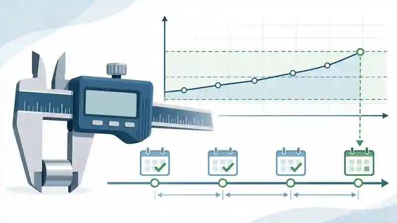
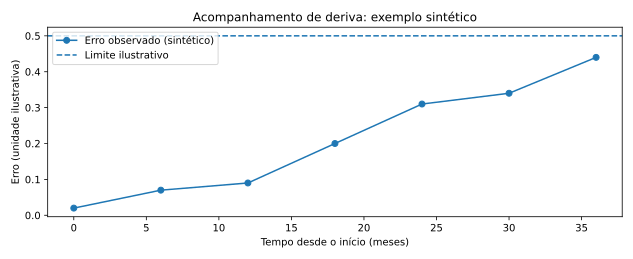

> **About this edition:** adapted for the academic website from an original article published on [LinkedIn](https://www.linkedin.com/pulse/como-determinar-os-intervalos-entre-calibra%C3%A7%C3%B5es-dos-de-ruan-mayworm-vx4me/) on 28 January 2025. The original themes and main examples have been preserved, with editing for web publication and new technical illustrations. The original LinkedIn images have not been reused because copies of verifiable quality could not be retrieved. Additional technical notes are identified as clarifications in this edition.

Deciding when a measuring instrument should next be calibrated involves metrological, operational and economic considerations. Applying the same fixed interval to every instrument may increase costs unnecessarily or allow significant performance changes to go undetected.

## Why review calibration intervals?

Periodic monitoring seeks to identify drift and instability, reduce the risk of decisions based on unsuitable measurements and ensure that calibration information remains adequate for its intended use. **Metrological traceability** is established through a documented chain of calibrations and comparisons, not simply by the chosen calibration frequency.

## Factors affecting calibration frequency

The original article highlights manufacturers' recommendations, environmental conditions, frequency of use, previous calibration results, measurement criticality and required uncertainty. Decisions should combine this evidence with the consequences of failure and actual operating conditions.

For example, two instruments of the same model may warrant different intervals if one operates in a controlled environment while the other is exposed to vibration, overload or intensive use.

## Methods for establishing and reviewing intervals

### Initial interval selection

An initial interval may be based on documented experience, technical recommendations and applicable contractual or regulatory requirements. It should be **reviewed once sufficient results become available**.

### Calibration history and the Schumacher method

One approach discussed in the original article is to classify previous results as conforming, nonconforming or damaged and use the observed sequences to propose shorter, unchanged or longer intervals. The method requires predefined rules and consistent records; it does not automatically justify extending calibration intervals.

### Control charts and trends

Charts of measurement errors or corrections over time can help detect drift and dispersion. A succession of results close to an acceptance limit may indicate that an earlier review is necessary, even if the most recent certificate reported conformity.

{#fig-historico-calibracao fig-cap="Synthetic series illustrating trend monitoring. It does not represent actual laboratory results or data from the original article."}

### Reviewing calibration certificates

In addition to the conforming/nonconforming decision, it is useful to examine the **magnitude of the measurement error**, **expanded uncertainty** and **remaining margin** relative to the specified limit. Unstable instruments may warrant shorter intervals, intermediate checks or investigation of their operating conditions.

## Guidelines and the relationship between tolerance and uncertainty

The original article refers to OIML D 10 and ISO 10012 for the management of measurement systems and the determination of intervals. The ratio of tolerance to uncertainty can help assess whether the metrological capability is appropriate for an application; however, **it does not determine calibration frequency on its own**. Reference thresholds adopted by an organisation must be technically justified.

## Conclusion

A calibration interval is a **metrological management decision based on risk and evidence**. Regular reviews should balance reliability, performance history and cost, using documented criteria suited to the criticality of the measurements.

## References and Sources

- **ILAC-G24:2022 / OIML D 10:2022.** *Guidelines for the determination of recalibration intervals of measuring equipment*. [Official document](https://www.oiml.org/en/files/pdf_d/d010-e22.pdf).

- **ISO 10012:2026.** *Quality management — Requirements for measurement management systems*. [Official ISO entry](https://committee.iso.org/standard/10012). **Historical note:** ISO 10012:2003 was the edition in force when the original article was written.

- **ISO/IEC 17025:2017.** *General requirements for the competence of testing and calibration laboratories*. Brazilian adoption: ABNT NBR ISO/IEC 17025:2017.

- **Albertazzi, A.; Sousa, A. R. de.** *Fundamentos de Metrologia Científica e Industrial*. 2nd edition. Manole, 2017. [Bibliographic record (Portuguese)](https://minhabiblioteca.com.br/catalogo/livro/79470/fundamentos-de-metrologia-cient-fica-e-industrial/).

## Further Reading

- [The Fascinating Journey of Metrology: From Antiquity to the Present Day](../a-fascinante-jornada-da-metrologia/index.qmd)
- [Critical Review of Calibration Certificates: A Practical Guide](../analise-critica-certificados-calibracao/index.qmd)
- [Accuracy vs Precision: What Is the Difference and Why Does It Matter in Measurement?](../exatidao-e-precisao/index.qmd)
- [Uncertainty Estimation in Linear Regression: A Practical Guide with Python](../incerteza-regressao-linear-python/index.qmd)
- **How to Determine Calibration Intervals for Measuring Equipment** *(this article)*
