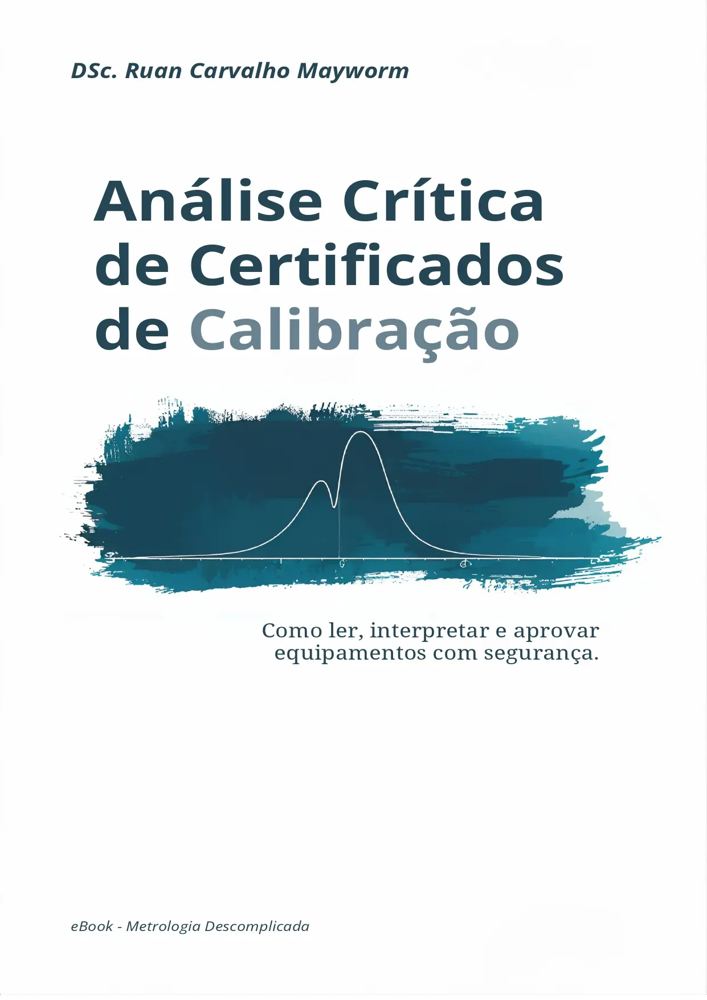

Digital library

## Análise Crítica de Certificados de Calibração

::: {.book-feature .ebook-feature}
::: {.ebook-cover-wrap}

:::
::: {.book-details}
First edition · 2026

**Ruan Carvalho Mayworm**

*Critical review of calibration certificates: how to read, interpret and make well-founded equipment decisions.*

A technical guide to interpreting calibration certificates, metrological traceability, acceptance criteria, decision rules, calibration intervals and the suitability of measuring instruments for their intended use. Includes practical examples and metrological management guidance.

**Language availability:** the online book and commercial PDF edition are currently in **Portuguese**; this catalogue description has been translated into English.

**Free online reading (Portuguese):** [open the book and browse its chapters](https://rcmayworm.github.io/livro-analise-certificados/).

**Commercial PDF edition (Portuguese):** [purchase the PDF](https://go.hotmart.com/F105183714N){target="_blank" rel="noopener noreferrer"}
:::
:::
