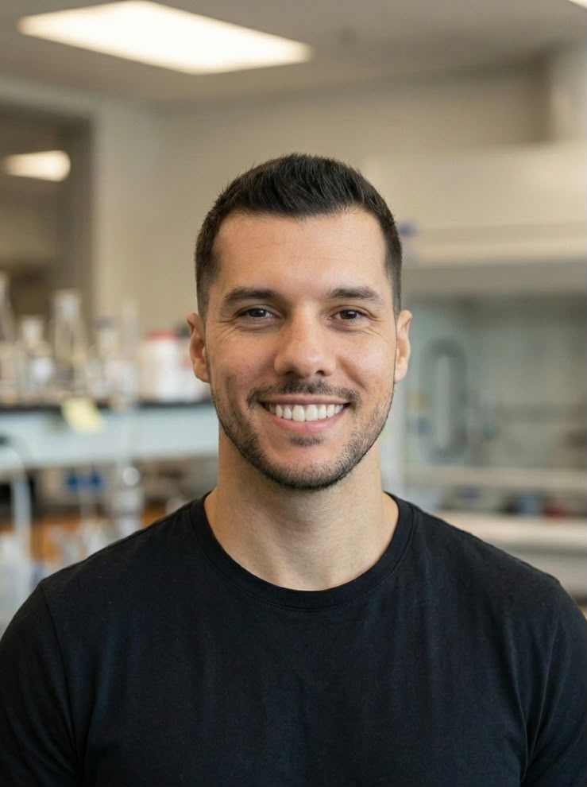
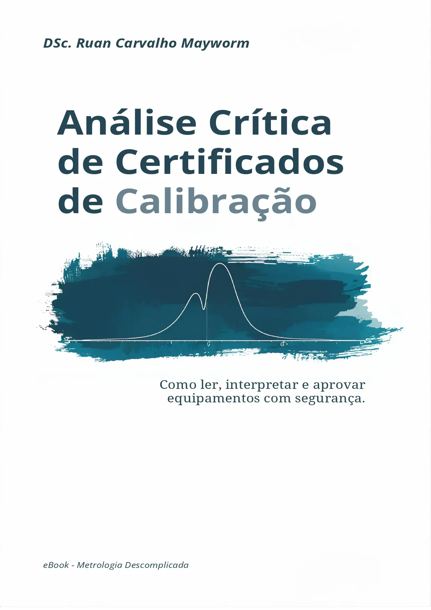

::: {.academic-hero}
::: {.hero-grid}
::: {}

Metrology · Quality · Data Analysis

<h1 class="hero-title">Ruan Mayworm</h1>

Mechanical Engineer · MSc and PhD in Metrology

I work at the intersection of metrology, statistics and data analysis, with experience in scientific instrumentation, signal processing, measurement uncertainty evaluation and quality management. I develop Python applications and explore the use of machine learning and optimisation in measurement systems, particularly in acoustics and ultrasound.

MetrologyQualityStatisticsData analysisMachine Learning

<a class="hero-btn hero-btn-primary" href="ebooks.html">E-books</a><a class="hero-btn hero-btn-secondary" href="blog/">Blog</a><a class="hero-btn hero-btn-secondary" href="publications.html">My publications</a><a class="hero-btn hero-btn-secondary" href="about.html">About me</a>

:::
::: {.hero-photo}

:::
:::
:::

Digital library

## [E-books and technical resources](ebooks.qmd){.home-heading-link}

::: {.book-feature .ebook-feature}
::: {.ebook-cover-wrap}

:::
::: {.book-details}
First edition · 2026

### Análise Crítica de Certificados de Calibração

*How to read and interpret calibration certificates and make sound equipment decisions.*

A practical guide to interpreting calibration certificates, establishing acceptance criteria and making evidence-based decisions about measuring equipment. **The book is currently available in Portuguese.**

[Read free online (Portuguese)](https://rcmayworm.github.io/livro-analise-certificados/) · [Purchase the PDF edition (Portuguese)](https://go.hotmart.com/F105183714N){target="_blank" rel="noopener noreferrer"}
:::
:::

Articles and science communication

## [Blog](blog/index.qmd){.home-heading-link} {.home-compact-heading}

Technical articles, research notes and tutorials. Use the arrows to browse the posts when more articles are available.

<button class="blog-carousel-arrow" id="blog-prev" type="button" aria-controls="home-blog-listing" aria-label="Previous articles" hidden>‹</button>
<button class="blog-carousel-arrow" id="blog-next" type="button" aria-controls="home-blog-listing" aria-label="Next articles" hidden>›</button>

::: {#home-blog-listing .home-blog-listing}
:::

[View all blog articles](blog/index.qmd){.inline-link}

Scientific output

## [Featured research and publications](publications.qmd){.home-heading-link} {.home-compact-heading}

Explore documented projects and scientific papers, with links to the original references and DOI identifiers.

::: {.feature-grid}
::: {.feature-card}

Ultrasound metrology

### Kibble balance and ultrasonic power

Experimental development for measuring ultrasonic power through radiation force.

[*Measurement* (2022)](https://doi.org/10.1016/j.measurement.2022.111788) · [*Acta IMEKO* (2025)](https://doi.org/10.21014/actaimeko.v14i2.1946)
:::
::: {.feature-card}

Non-destructive testing

### ToFD technique

Metrological studies of the *Time-of-Flight Diffraction* technique for ultrasonic detection and characterisation of discontinuities.

[*Measurement* (2021)](https://doi.org/10.1016/j.measurement.2020.108298) · [Research](research.qmd)
:::
:::

Tools and resources

## Academic resources {.home-compact-heading}

::: {.feature-grid}
::: {.feature-card .feature-card-clickable}
### [Scientific software](software.qmd){.feature-card-link}

Repositories, programs and tools for data analysis, automation and scientific research.
:::
::: {.feature-card .feature-card-clickable}
### [Presentations and talks](presentations.qmd){.feature-card-link}

A space for academic presentations and conference materials.
:::
:::

Professional background

## About me and professional profiles {.home-compact-heading}

::: {.feature-grid .three}
::: {.feature-card .feature-card-clickable}

About me

### [Education and experience](about.qmd){.feature-card-link}

Learn about my academic qualifications, professional background and research interests.
:::
::: {.feature-card .feature-card-clickable}

Academic CV

### [Lattes CV](http://lattes.cnpq.br/5951712664292058){.feature-card-link target="_blank" rel="noopener noreferrer"}

Visit my CV on the Brazilian Lattes Platform for my educational background and scientific output.
:::
::: {.feature-card .feature-card-clickable}

Professional network

### [LinkedIn](https://www.linkedin.com/in/ruanmayworm/){.feature-card-link target="_blank" rel="noopener noreferrer"}

Visit my professional profile to learn about my experience and shared publications.
:::
:::

