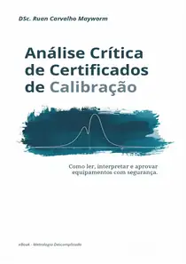

::: {.academic-hero}
::: {.hero-grid}
::: {}

Metrologia · Qualidade · Análise de Dados

<h1 class="hero-title">Ruan Mayworm</h1>

Engenheiro mecânico · Mestre e doutor em Metrologia

Atuo na interface entre metrologia, estatística e análise de dados, com experiência em instrumentação científica, processamento de sinais, avaliação da incerteza de medição e gestão da qualidade. Desenvolvo aplicações em Python e investigo o uso de machine learning e otimização em sistemas de medição, especialmente em acústica e ultrassom.

MetrologiaEstatísticaMachine LearningAnálise de dadosQualidade

<a class="hero-btn hero-btn-primary" href="ebooks.html">E-books</a><a class="hero-btn hero-btn-secondary" href="blog/">Blog</a><a class="hero-btn hero-btn-secondary" href="publications.html">Minhas publicações</a><a class="hero-btn hero-btn-secondary" href="about.html">Sobre mim</a>

:::
::: {.hero-photo}

:::
:::
:::

Biblioteca digital

## E-books e conteúdo técnico

::: {.book-feature .ebook-feature}
::: {.ebook-cover-wrap}

:::
::: {.book-details}
1ª edição · 2026

### Análise Crítica de Certificados de Calibração

*Como ler, interpretar e aprovar equipamentos com segurança.*

Um guia prático para interpretar certificados de calibração, estabelecer critérios de aceitação e fundamentar decisões sobre equipamentos de medição.

**Leitura online gratuita:** [ler os capítulos no site](https://rcmayworm.github.io/livro-analise-certificados/). **Edição PDF:** disponível para aquisição na Hotmart.

[Conhecer o livro](ebooks.qmd){.inline-link} · [Ler gratuitamente](https://rcmayworm.github.io/livro-analise-certificados/) · [Comprar edição PDF](https://go.hotmart.com/F105183714N){target="_blank" rel="noopener noreferrer"}
:::
:::

Artigos e divulgação científica

## Blog

Artigos, notas técnicas e tutoriais publicados. Use as setas para explorar as postagens quando houver mais conteúdos disponíveis.

<button class="blog-carousel-arrow" id="blog-prev" type="button" aria-controls="home-blog-listing" aria-label="Ver artigos anteriores" hidden>‹</button>
<button class="blog-carousel-arrow" id="blog-next" type="button" aria-controls="home-blog-listing" aria-label="Ver próximos artigos" hidden>›</button>

::: {#home-blog-listing .home-blog-listing}
:::

[Ver todos os artigos do blog](blog/index.qmd){.inline-link}

Produção científica

## Pesquisa e publicações em destaque

Conheça projetos e artigos já documentados, com acesso às referências originais e seus identificadores DOI.

::: {.feature-grid}
::: {.feature-card}

Metrologia ultrassônica

### Balança de Kibble e potência ultrassônica

Desenvolvimento experimental para medição de potência ultrassônica por força de radiação.

[*Measurement* (2022)](https://doi.org/10.1016/j.measurement.2022.111788) · [*Acta IMEKO* (2025)](https://doi.org/10.21014/actaimeko.v14i2.1946)
:::
::: {.feature-card}

Ensaios não destrutivos

### Técnica ToFD

Estudos metrológicos da técnica *Time-of-Flight Diffraction* aplicada à avaliação de descontinuidades por ultrassom.

[*Measurement* (2021)](https://doi.org/10.1016/j.measurement.2020.108298) · [Pesquisa](research.qmd)
:::
:::

Ferramentas e materiais

## Recursos acadêmicos

::: {.feature-grid}
::: {.feature-card}

Software

### Código científico

Repositórios, programas e ferramentas para análise de dados, automação e pesquisa, conforme disponibilidade de versões públicas.

[Explorar software e código](software.qmd)
:::
::: {.feature-card}

Apresentações

### Palestras e materiais técnicos

Espaço para disponibilizar apresentações acadêmicas e materiais de palestras, após revisão e autorização.

[Ver apresentações](presentations.qmd)
:::
:::

Trajetória profissional

## Sobre mim e perfis

::: {.feature-grid .three}
::: {.feature-card}

Sobre mim

### Formação e experiência

Conheça minha formação acadêmica, trajetória profissional e áreas de atuação.

[Sobre mim](about.qmd)
:::
::: {.feature-card}

Currículo acadêmico

### Currículo Lattes

Acesse meu currículo na Plataforma Lattes, com histórico de formação e produção acadêmica.

[Consultar currículo Lattes](http://lattes.cnpq.br/5951712664292058){target="_blank" rel="noopener noreferrer"}
:::
::: {.feature-card}

Rede profissional

### LinkedIn

Acesse meu perfil profissional para conhecer experiências e publicações compartilhadas.

[Visitar LinkedIn](https://www.linkedin.com/in/ruanmayworm/){target="_blank" rel="noopener noreferrer"}
:::
:::

