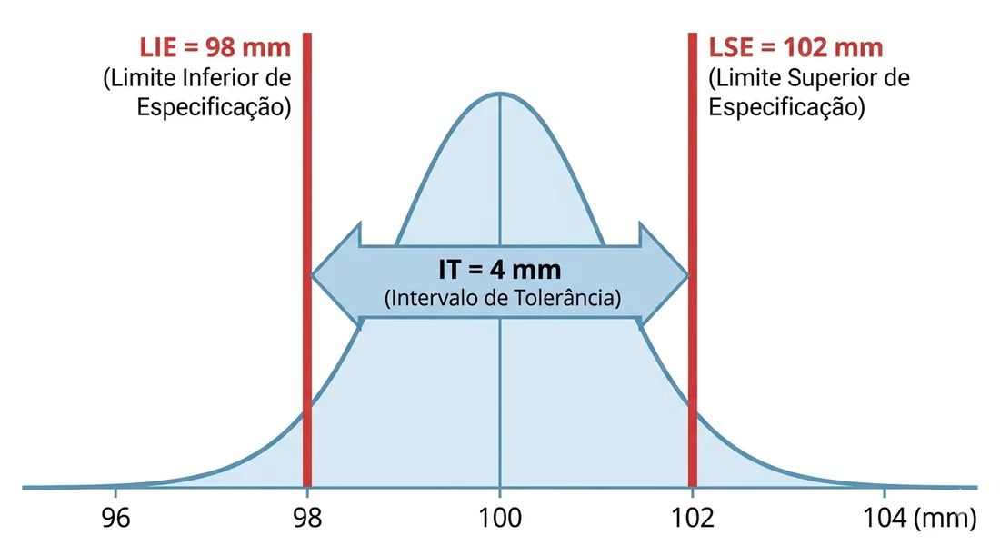
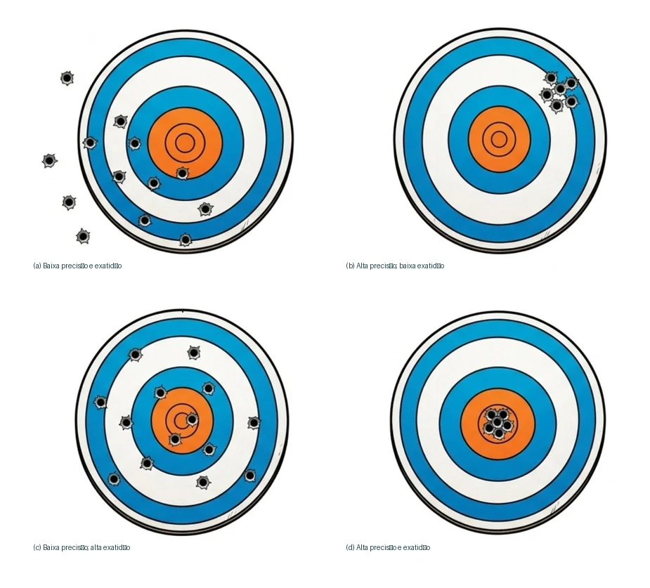

# Como Definir o Critério de Aceitação

::: {.callout-warning title="Alerta de auditoria"}
Auditores de sistemas de gestão costumam registrar **não conformidades** quando empresas apenas arquivam o certificado sem evidenciar a análise crítica técnica. Você deve comprovar documentalmente que verificou se o Máximo Desvio ($MD$) é inferior ao Critério de Aceitação ($EMP$) definido para o seu processo.
:::

A maioria dos profissionais comete o erro estratégico de acreditar que a exatidão de um instrumento é definida por sua resolução ou pelo que o laboratório escreve no certificado. Na realidade, o laboratório apenas relata como o instrumento se comporta, mas quem define o limite do aceitável é você. O **Erro Máximo Permitido (EMP)** é o "divisor de águas" entre uma medição confiável e um prejuízo financeiro. Ele deve nascer das necessidades do seu **processo** e do seu produto, pois um erro de 0,1 mm pode ser irrelevante para uma fundição, mas catastrófico para uma linha de microchips [@iso10012].

## Entendendo a Tolerância do Processo

{#fig-tolerancia fig-alt="Curva de frequência com limites LIE 98 mm e LSE 102 mm"}

A **Tolerância do Processo** é a "folga" permitida para que o seu produto ainda funcione corretamente ou atenda aos requisitos de segurança e qualidade. Ela representa o limite aceitável de variação no seu processo de fabricação. Enquanto o erro do instrumento é uma característica do equipamento, a tolerância é um mandato do projeto ou do seu cliente.

O **Intervalo de Tolerância (IT)**, Figura @fig-tolerancia, é a diferença entre o Limite Superior de Especificação (LSE) e o Limite Inferior de Especificação (LIE). Por exemplo: se um eixo usinado deve ter uma dimensão de $100 \text{ mm} \pm 2 \text{ mm}$, seu LIE é 98 mm e seu LSE é 102 mm. O seu Intervalo de Tolerância (IT) é de $4 \text{ mm}$. É sobre esse valor de 4 mm que você deve basear toda a sua estratégia de medição.

## Exatidão vs. Precisão

Antes de calcularmos o limite aceitável, precisamos visualizar o comportamento do instrumento. Uma forma prática de diferenciar os conceitos de exatidão e precisão é imaginar um alvo, conforme demonstrado na Figura @fig-alvos.

A **Tendência** (Erro Sistemático) é a distância entre o "centro do agrupamento dos tiros" (média das medições) e o "centro do alvo" (valor de referência). Se todos os buracos de tiros estão agrupados, mas longe do centro, o instrumento é preciso mas não é exato, pois possui uma tendência que precisa de correção.

A **Precisão** (Erro Aleatório) reflete o "espalhamento" dos buracos de tiros entre si. Quanto mais distribuídos eles estão, menor é a repetibilidade do seu instrumento e, consequentemente, maior será a margem de dúvida (Incerteza de Medição) que você terá que considerar na sua análise. O cenário ideal para o seu processo é ter os tiros agrupados (boa precisão) e exatamente no centro do alvo (boa exatidão).

{#fig-alvos fig-alt="Quatro alvos ilustrando combinações de dispersão e desvio sistemático"}

Para não cometer erros conceituais em auditorias, grave as definições oficiais do *Vocabulário Internacional de Metrologia* (VIM):

::: {.callout-tip title="Dica prática"}
Pense o seguinte para memorizar: o que é **preciso** se repete, mas pode precisar de melhorias para ser **exato**. Se o seu instrumento é preciso mas tem erro sistemático alto, você pode corrigi-lo via software ou tabela de calibração. Se ele não tem precisão (tiros espalhados), o equipamento é instável e provavelmente não é adequado para o seu processo.
:::

-   **Exatidão de Medição (VIM 2.13):** grau de concordância entre um valor medido e um valor verdadeiro de um mensurando. É um conceito qualitativo, uma medição é dita "mais exata" quando apresenta um erro menor.

-   **Precisão de Medição (VIM 2.15):** grau de concordância entre indicações ou valores medidos, obtidos por medições repetidas no mesmo objeto, sob condições especificadas. Note que a precisão não tem relação com o valor verdadeiro, mas apenas com a repetibilidade dos dados.

## Métodos práticos para encontrar o EMP

Agora que você entende que precisamos controlar tanto a exatidão quanto a precisão dos equipamentos, como definir o limite máximo aceitável para eles? Para sair do achismo, você deve adotar uma base técnica sólida. Aqui estão as três formas mais seguras e aceitas em auditorias:

1.  **Baseado em Normas Técnicas do Produto:** Muitos setores possuem normas específicas que já ditam o erro máximo que um instrumento pode ter para realizar aquele ensaio. É o caso, por exemplo, da norma NBR 14105 para manômetros, que define classes de exatidão específicas para cada uso [@nbr14105].

2.  **Baseado no Manual do Fabricante:** Se o seu processo não possui uma norma específica, o primeiro passo é consultar o manual do fabricante do instrumento. Ele indica o limite de erro que o projeto daquele equipamento deve respeitar. No entanto, cuidado: nem sempre o que o fabricante garante é suficiente para a precisão que seu cliente exige.

    ::: {.callout-tip title="Dica prática"}
Documente o seu critério de aceitação **antes** do instrumento ir para a calibração. Crie uma planilha de gestão de ativos onde conste a coluna "Tolerância do Produto" e a coluna "EMP Definido". Ao receber o certificado, o seu sistema deve comparar automaticamente os dados.
:::

3.  **Baseado na Tolerância do Processo:** Este é o método mais eficaz para gerenciar riscos. O EMP deve ser uma fração da tolerância do seu produto. A metrologia industrial utiliza a regra empírica de dividir o intervalo de tolerância (IT) por um fator $\beta$. A recomendação clássica é que o erro não ultrapasse **1/10 (10%)** da tolerância para processos de alta criticidade, ou ao menos **1/3 (33%)** para processos menos estáveis [@albertazzi2008].

## Como Escolher o Instrumento Correto (Regra de Ouro)

::: {.callout-tip title="Dica prática"}
Antes de investir em equipamentos de alta tecnologia, aplique a conta simples: se a sua tolerância é de 1,0 mm, procure um instrumento cuja incerteza combinada com o erro não ultrapasse 0,1 mm (Regra de 1/10). Muitas vezes, um instrumento mais simples e robusto atende perfeitamente ao seu processo, evitando gastos excessivos com calibrações.
:::

A seleção de um instrumento de medição deve ser um equilíbrio entre exatidão técnica e viabilidade econômica. Se você escolher um instrumento pouco exato, terá produtos fora de especificação; se escolher um instrumento excessivamente preciso para um processo bruto, estará desperdiçando dinheiro da empresa.

A metrologia industrial utiliza a chamada **"Regra de Ouro"** (ou relação de exatidão TUR/TAR), que recomenda que o erro e a incerteza do instrumento sejam uma fração do seu intervalo de tolerância de processo. A experiência prática mostra que a incerteza total do processo de medição não deve ultrapassar 1/4 a 1/10 da tolerância do produto.
