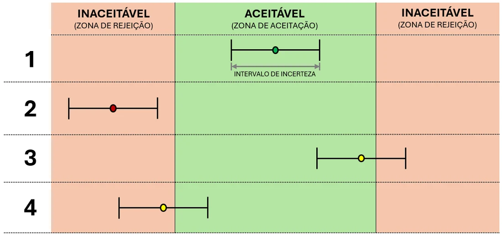

# A Regra de Ouro da Aprovação

## A Fórmula da Aceitação

Para dar o veredito final sobre um equipamento, não basta olhar apenas para o erro. Você precisa considerar a "equação final" da confiança metrológica. Uma regra de decisão conservadora frequentemente utilizada para considerar erro e incerteza é:

$$|Erro| + U \leq EMP$$

Onde:

-   **$|Erro|$:** é o valor absoluto da *Tendência* (o quanto o instrumento está "viciado") relatado no certificado.

-   **$U$:** é a *Incerteza Expandida*, ou seja, a margem de dúvida que o laboratório declara para aquele resultado.

-   **$EMP$:** é o seu *Erro Máximo Permitido* (Critério de Aceitação) definido no capítulo anterior.

Se a soma do erro com a incerteza ultrapassar o limite, **essa regra de decisão não permite declarar conformidade**. A ação subsequente — ajuste, restrição, investigação ou nova calibração — depende dos requisitos metrológicos e da análise de risco. Outras regras de decisão podem ser apropriadas quando explicitamente definidas e justificadas [@iso10012; @ilacg8].

## Risco de Falsa Aceitação

::: {.callout-warning title="Alerta de auditoria"}
Aprovar equipamentos na zona de dúvida sem aplicar uma regra de decisão clara é o maior motivo de *recalls* e multas na indústria. Se o seu processo é de segurança ou saúde, o ILAC G8 recomenda o uso de **Zonas de Guarda**, onde você reduz o seu limite de aceitação pelo valor da incerteza, reduzindo o risco de falsa aceitação sob hipóteses definidas; nenhum critério assegura risco universalmente nulo.
:::

Para que sua análise crítica tenha validade internacional, baseamo-nos nas diretrizes da **ILAC (Cooperação Internacional de Acreditação de Laboratórios)**, a entidade global que harmoniza as práticas de laboratórios e organismos de acreditação em todo o mundo [@ilacg8]. O documento técnico **ILAC G8** é o guia definitivo que ensina como a incerteza de medição deve ser contabilizada ao declarar a conformidade de um item contra uma especificação.

O grande desafio surge quando o resultado do seu instrumento cai na chamada **"Zona de Dúvida"**. Isso acontece quando o erro, sozinho, parece estar dentro do limite, mas, ao somar a incerteza, a "janela de dúvida" ultrapassa o seu EMP. Nesse caso, a aceitação sem banda de guarda pode envolver **risco de falsa aceitação**. A probabilidade desse evento depende do modelo estatístico, da incerteza, da regra de decisão e da distância do resultado ao limite; **não se deve atribuir automaticamente 50% de risco** a qualquer zona de dúvida [@ilacg8]. Em processos críticos, é necessário explicitar e justificar o risco admitido.

## Os 4 Cenários de Decisão (Diretrizes ILAC G8)

Ao analisar o certificado, você deve confrontar o **$|Erro|$** somado à incerteza (U) contra o seu Erro Máximo Permitido (EMP). Segundo as diretrizes do guia *ILAC G8*, existem quatro cenários clássicos que definem a vida do seu equipamento, conforme ilustrado na Figura @fig-zonas-decisao [@ilacg8]:

1.  **Aprovação Clara:** O erro relatado e toda a barra de incerteza estão totalmente dentro dos limites do seu EMP. O risco de o instrumento estar fora da especificação é mínimo.

2.  **Reprovação Clara:** O erro e a incerteza estão totalmente fora dos limites estabelecidos. O equipamento deve ser retirado de uso imediatamente.

3.  **Falsa Aceitação (Zona de Dúvida):** O erro (tendência) está dentro do limite, mas a "franja" da incerteza ultrapassa o seu EMP. Há risco de aceitar um equipamento **não conforme**; sua probabilidade não pode ser quantificada sem um modelo de incerteza e uma regra de decisão definidos.

4.  **Falsa Rejeição (Zona de Dúvida):** O erro está fora do limite, mas a barra de incerteza invade a área de aprovação. Você pode estar descartando ou enviando para conserto um instrumento que ainda está bom.

{#fig-zonas-decisao fig-alt="Quatro casos com pontos e barras de incerteza em zonas de aceitação e rejeição"}

Para as Zonas de Dúvida (Casos 3 e 4), a empresa deve adotar uma **Regra de Decisão** clara: ou utiliza Zonas de Guarda para aceitar resultados que atendam a critérios de risco mais restritivos, ou assume o "Risco Compartilhado" com o cliente, documentando essa decisão durante a análise crítica do pedido.
