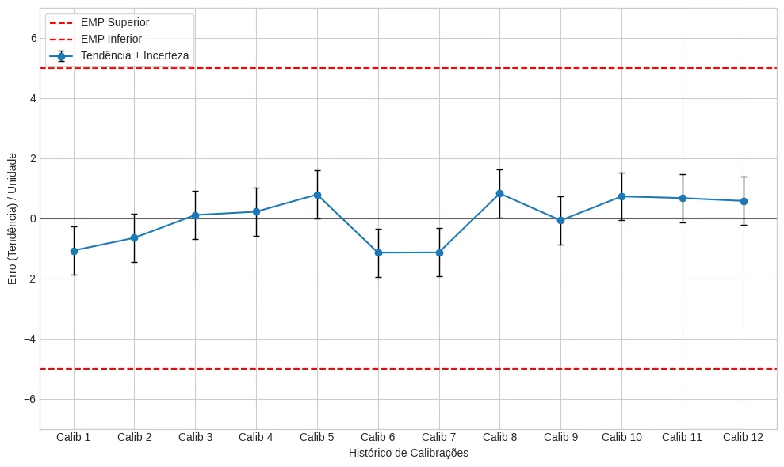
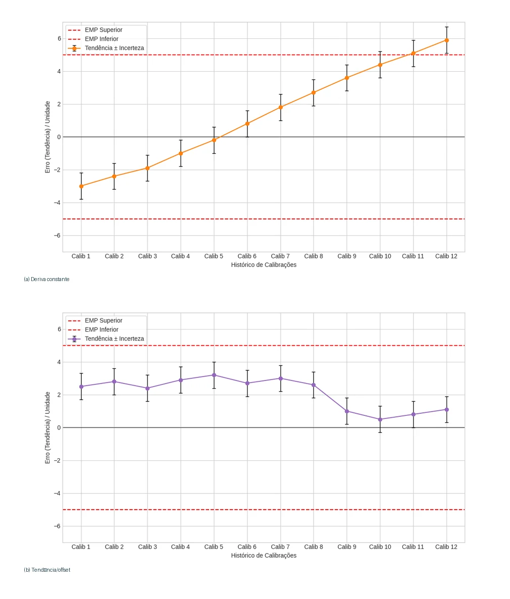

# Frequência de Calibração

## Como definir e estender prazos com segurança

::: {.callout-note title="O que é o ILAC G24"}
Este documento é uma diretriz conjunta entre a **ILAC** (entidade máxima da acreditação laboratorial) e a **OIML** (Organização Internacional de Metrologia Legal). Ele é um documento de referência que ensina como migrar de prazos fixos para intervalos baseados em desempenho e risco metrológico.
:::

::: {.callout-warning title="Alerta de auditoria"}
Lembre-se: de acordo com o item 7.8.4.3 da ISO/IEC 17025, o laboratório é proibido de recomendar intervalos de calibração no certificado ou na etiqueta, exceto se houver um acordo prévio e documentado com você. Aceitar um prazo de 1 ano "imposto" pelo prestador de serviço, sem uma análise de risco baseada no seu histórico de uso, é uma falha de gestão que gera **não conformidade** em auditorias.
:::

A regra de "calibrar uma vez ao ano" é um mito administrativo que gera desperdício financeiro e não garante a qualidade. Para sair dessa armadilha, utilizamos como base o guia internacional **ILAC G24 / OIML D 10** [@ilacg24].

Segundo o guia, a frequência ideal de calibração depende de um balanço técnico entre o risco de erro e o custo de manutenção. A escolha inicial do intervalo deve considerar fatores críticos como a severidade do ambiente de uso (presença de poeira, umidade ou vibração), a frequência de utilização do ativo e a incerteza de medição requerida pelo seu processo. Na prática, equipamentos usados em três turnos no chão de fábrica exigem intervalos menores do que aqueles mantidos em ambiente climatizado e de uso esporádico.

Para decidir se você pode estender um prazo com segurança, ensinaremos as duas técnicas mais aceitas em auditorias.

::: {.callout-warning title="Alerta de auditoria"}
Aprovar a extensão de um prazo sem evidenciar o cálculo de Schumacher ou o gráfico de tendências é "achismo". Auditores de sistemas de gestão exigem que a justificativa técnica para a alteração de prazos esteja documentada no seu plano de calibração.
:::

## Técnica 1: Método de Schumacher (Análise de Histórico)

Este é o método mais prático para quem está começando a organizar a gestão. Ele baseia-se na classificação do estado do instrumento em cada calibração realizada. Para aplicá-lo, você precisa de um ciclo histórico de, no mínimo, 3 calibrações.

### Passo 1: Classifique seus resultados {.unnumbered}

Ao receber o certificado, atribua uma destas três letras ao evento:

-   **(C) Conforme:** O instrumento foi aprovado no seu Critério de Aceitação ($|E| + U \leq EMP$).

-   **(F) Fora da exatidão:** O instrumento foi reprovado (erro acima do permitido).

-   **(A) Avaria:** O instrumento apresentava defeito físico ou eletrônico antes da calibração.

::: {.callout-tip title="Dica prática"}
Se o seu paquímetro é calibrado a cada 12 meses e teve 3 resultados "Conforme" (CCC), uma política interna inspirada no método de Schumacher pode considerar ampliar o intervalo, por exemplo de 12 para 14,4 meses (+20%), somente após análise documentada do histórico, criticidade, estabilidade e risco.
:::

### Passo 2: Aplique a Regra de Decisão {.unnumbered}

Com base na sequência de resultados (ex: CCC, FCC), você define o ajuste do próximo prazo:

| Sequência histórica | Decisão estratégica | Ajuste sugerido |
|:--|:--|:--|
| **CCC** | E (Estender o prazo) | +20% do tempo atual |
| **CCF ou FCF** | D (Diminuir o prazo) | −10% do tempo atual |
| **CFF ou FFF** | M (Máxima redução) | −35% do tempo atual |
| **Outras (CFC, ACC)** | P (Permanecer) | Manter o prazo atual |

*Os percentuais exemplificam uma política interna de gestão de intervalos; não são imposições normativas nem autorização automática de extensão.*

: Matriz de decisão Schumacher para ciclo de três calibrações. {#tbl-schumacher}

## Técnica 2: Análise de Tendências (Cartas de Controle)

::: {.callout-tip title="Dica prática"}
Crie um gráfico de linhas no Excel: no eixo horizontal (X) coloque a data das calibrações e no eixo vertical (Y) coloque o valor da Tendência (Erro) relatado no certificado. Adicione linhas horizontais fixas representando o seu EMP superior e inferior.
:::

Para ativos de alta criticidade, a ISO 10012 e a ISO/IEC 17025 recomendam o monitoramento da **Deriva Instrumental** via gráficos. Aqui, você não olha apenas se o instrumento "passou", mas sim para *onde* o erro está caminhando. O cenário ideal é um instrumento com variações aleatórias contidas, conforme ilustrado na Figura @fig-carta-ideal.

{#fig-carta-ideal fig-alt="Erros de medição variam dentro dos limites horizontais estabelecidos"}

### O que o gráfico te diz (A "Regra dos 7"): {.unnumbered}

Fique atento a desvios que indicam que o instrumento está perdendo a estabilidade, mesmo que ainda esteja "dentro da faixa". A Figura @fig-cartas-problema ilustra os dois principais alertas que você deve buscar no seu histórico:

1.  **Deriva Constante (Vide Figura @fig-cartas-problema (a)):** Se você observar 7 pontos sucessivos em linha ascendente ou descendente, o instrumento está se desgastando e deve ser ajustado antes de falhar (cruzar a linha do EMP).

2.  **Vício de Medição (Vide Figura @fig-cartas-problema (b)):** Se houver 7 pontos sucessivos acima ou abaixo da linha média (zero), o instrumento possui um erro sistemático que pode ser compensado via correção no seu processo, aumentando a exatidão da sua medição sem necessidade de ajuste físico.

{#fig-cartas-problema fig-alt="Dois gráficos de controle: um com tendência ascendente e outro com erro sistemático"}

## A Base Normativa da Flexibilização

Não estamos inventando regras; estamos aplicando o que há de mais moderno na gestão de ativos global. A transição de prazos fixos para intervalos baseados em desempenho é uma diretriz clara dos seguintes órgãos:

-   **ILAC G24 / OIML D 10:** O documento internacional definitivo que valida o uso de métodos estatísticos e históricos para gerir a periodicidade [@ilacg24].

-   **ISO 10012:** A norma de gestão de medição que obriga o uso de históricos de calibração para a tomada de decisão sobre intervalos [@iso10012].

-   **Método Schumacher:** Uma abordagem prática e consagrada para a classificação do estado de conservação e conformidade de ativos industriais.

::: {.callout-tip title="Dica prática"}
Ao ser questionado por um auditor sobre o porquê de um paquímetro estar com 24 meses de intervalo, abra o seu Excel, mostre o gráfico de tendência e cite o **Método 2 da ILAC G24**. Isso demonstra que sua gestão é baseada em dados e risco, o nível mais alto de maturidade metrológica.
:::
