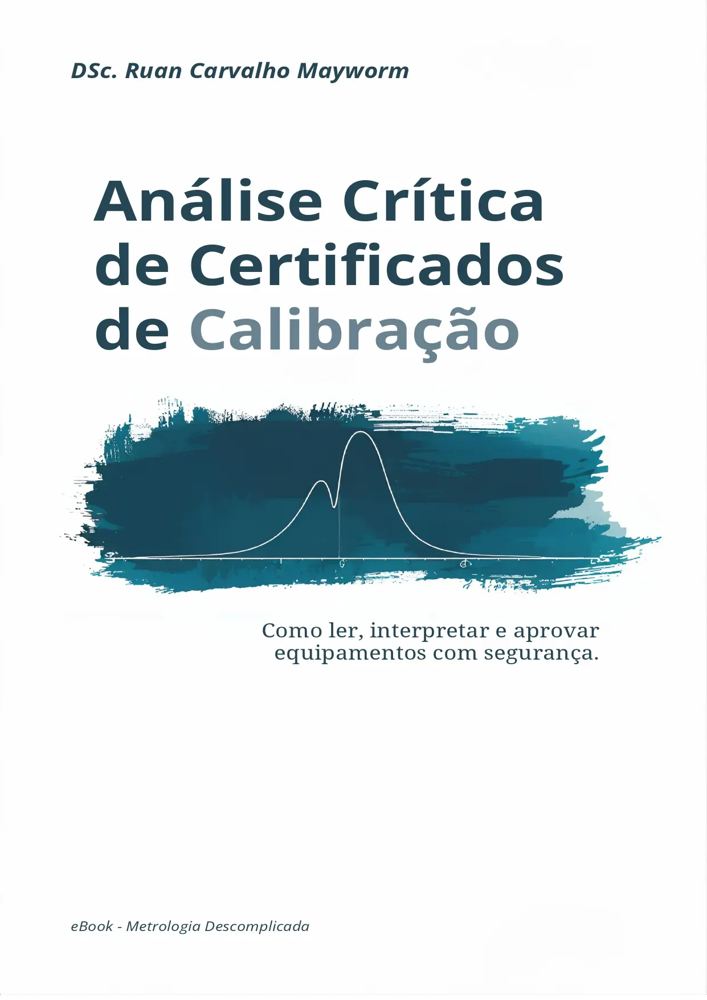

  <h1 class="book-opening-title">Análise Crítica de Certificados de Calibração</h1>
  
Como ler, interpretar e aprovar equipamentos com segurança.

  
  
<strong>Autor:</strong> Ruan Carvalho Mayworm

  
<strong>Publicação:</strong> 2026 · 1ª edição

**Leitura online gratuita.**

[Adquirir edição em PDF](https://go.hotmart.com/F105183714N){target="_blank" rel="noopener noreferrer"}

*© Ruan Carvalho Mayworm. Direitos reservados. Acesso gratuito para leitura, sem autorização automática para redistribuição ou comercialização.*

::: {.callout-note title="Nota editorial da versão online"}
Este livro disponibiliza gratuitamente o conteúdo da primeira edição, adaptado para leitura em HTML. Algumas afirmações técnicas receberam esclarecimentos para evitar interpretações normativas universais. Consulte a [nota de revisão editorial](revisao-editorial.qmd) antes de aplicar critérios em processos críticos. As figuras são ilustrativas.
:::

---

# Introdução: O Fim do Achismo na Metrologia {.unnumbered}
::: {.callout-note title="O que é a RBC"}
A Rede Brasileira de Calibração (RBC) congrega laboratórios cuja competência técnica é avaliada e acreditada pela Cgcre/Inmetro. O selo no certificado é a garantia de que as medições possuem rastreabilidade metrológica ininterrupta até o Sistema Internacional de Unidades (SI).
:::

O recebimento de um certificado de calibração é, muitas vezes, o início de uma insegurança técnica silenciosa. Para muitos engenheiros e gestores da qualidade, a "análise" do documento resume-se a verificar a presença do selo da RBC e arquivar o PDF, torcendo para que um auditor não aprofunde os questionamentos. No entanto, essa prática esconde um risco severo: a calibração, por si só, não atesta que o instrumento é adequado. Ela apenas descreve o comportamento do equipamento em um dado momento. Sem uma análise técnica, não é possível saber se o processo está gerando produtos defeituosos "dentro da tolerância" ou se está descartando lotes bons por erro do sistema de medição.

O custo da incerteza não se limita apenas ao medo de uma não conformidade em auditoria. Ele se traduz em desperdício de matéria-prima, retrabalho e, no limite, na perda de credibilidade perante o cliente quando dados incorretos chegam ao mercado. O profissional de chão de fábrica vive sob a pressão constante de reduzir custos, mas raramente possui as ferramentas metrológicas para decidir se pode estender o prazo de uma calibração ou se deve investir em um equipamento de maior exatidão para evitar riscos jurídicos e operacionais.

Este manual foi desenhado para eliminar o "achismo" da sua gestão e tem o objetivo de entregar um passo a passo prático para você assumir o controle total: desde o cálculo do Erro Máximo Permitido (EMP) baseado na sua tolerância real, passando pelas Regras de Decisão para gerenciar as zonas de dúvida, até o estabelecimento técnico de frequências de calibração que protejam seu orçamento e seu processo.
